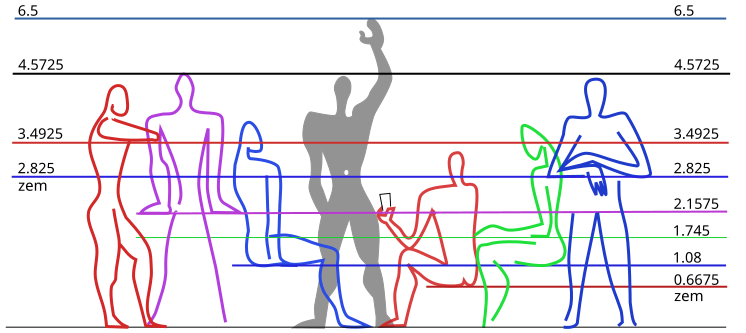
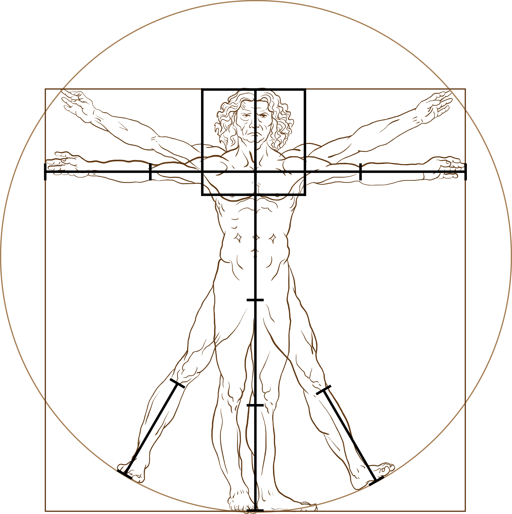

# Dec Measurement System

Code

Introducing Dec, a measurement system, which uses turns instead of months, weeks, hours, minutes, seconds, and degrees.

Author

[Martin Laptev](https://maptv.github.io)

Published

2026+243

Modified

2026+242

![]()

#### 0 Dec measurement system

This part of my website focuses on Dec, a [measurement system](https://en.wikipedia.org/wiki/System_of_units_of_measurement#:~:text=a%20collection%20of%20units%20of%20measurement%20and%20rules%20relating%20them%20to%20each%20other) that [I](https://maptv.github.io) created. All Dec measurements are based on [turns](https://en.wikipedia.org/wiki/Turn_%28angle%29#:~:text=a%20unit%20of%20plane%20angle%20measurement%20equal%20to%202%CF%80%C2%A0radians%2C%20360%C2%A0degrees). When measuring [angles](https://en.wikipedia.org/wiki/Angle#:~:text=the%20figure%20formed%20by%20two%20rays)📐, a [turn](https://en.wikipedia.org/wiki/Turn_%28angle%29#:~:text=the%20Greek%20letter,to%20one%20turn) ([t](#t)) represents a full⭕️circle and equals 360 [degrees](https://en.wikipedia.org/wiki/Degree_(angle)#:~:text=a%20measurement%20of%20a%20plane%20angle%20in%20which%20one%20full%20rotation%20is%20360%20degrees) ([°](#deg)) or [\\\underline\tau\\](#2pi), 2[𝜋](#pi), or 900[ϡ](#sampi) [radians](https://en.wikipedia.org/wiki/Radian#:~:text=the%20unit%20of%20angle%20in%20the%20International%20System%20of%20Units) ([rad](#rad)). [Geographic coordinates](https://en.wikipedia.org/wiki/Geographic_coordinate_system#:~:text=positions%20directly%20on%20Earth%20as%20latitude%20and%20longitude) and [compass](https://en.wikipedia.org/wiki/Compass#:~:text=a%20device%20that%20shows%20the%20cardinal%20directions%20used%20for%20navigation%20and%20geographic%20orientation)🧭directions are angles and thus can — and should — be measured in turns instead of [rad](#rad) or [°](#deg).

#### 1 Longitude latitude course

Dec measures [longitude](https://en.wikipedia.org/wiki/Longitude#:~:text=denoted%20by%20the%20Greek%20letter%20lambda) in [wěi](https://en.wiktionary.org/wiki/%E7%B7%AF#:~:text=(geography)-,latitude,-coordinate%20terms%C2%A0%E2%96%B2) ([w](#w)), [latitude](https://en.wikipedia.org/wiki/Latitude#:~:text=denoted%20by%20the%20Greek%20lower%2Dcase%20letter%20phi) in [jīng](https://en.wikipedia.org/wiki/Meridian_arc#Full_meridian_(polar_perimeter):~:text=The%20polar%20Earth%27s%20circumference%20is%20simply%20four%20times%20quarter%20meridian) ([j](#j)), and compass directions in [roses](https://en.wikipedia.org/wiki/Compass_rose#:~:text=a%20polar%20diagram%20displaying%20the%20orientation%20of%20the%20cardinal%20directions)🌹([r](#r)). To measure certain kinds of angles, Dec uses specific types of turns with distinct names like [w](#w), [j](#j), or [r](#r). All turn types can be combined with [metric prefixes](https://en.wikipedia.org/wiki/Metric_prefix#:~:text=a%20unit%20prefix%20that%20precedes%20a%20basic%20unit%20of%20measure%20to%20indicate%20a%20multiple%20or%20submultiple%20of%20the%20unit), like [deci](https://en.wikipedia.org/wiki/Deci-#:~:text=a%20decimal%20unit%20prefix%20in%20the%20metric%20system%20denoting%20a%20factor%20of%20one%20tenth), [centi](https://en.wikipedia.org/wiki/Centi-#:~:text=a%20unit%20prefix%20in%20the%20metric%20system%20denoting%20a%20factor%20of%20one%20hundredth), or [milli](https://en.wikipedia.org/wiki/Milli-#:~:text=a%20unit%20prefix%20in%20the%20metric%20system%20denoting%20a%20factor%20of%20one%20thousandth), to create turn [submultiples](https://en.wikipedia.org/wiki/Multiple_%28mathematics%29#:~:text=of%20%22a%20being-,a%20unit%20fraction,-of%20b%22%20%28a), such as deciturns ([dt](#dt)), centiturns ([ct](#ct)), or milliturns ([mt](#mt)).

[Table 1](#tbl-map) below⬇️provides the current longitude in milliwěi ([mw](#mw)) and latitude in millijīng ([mj](#mj)) of Points 0 and 1 on the [map](#fig-distmap)🗺️beneath [Table 1](#tbl-map). By default, Point 0 is at 800 [mw](#mw) and 0 [mj](#mj), near the [Galápagos🏝️archipelago](https://en.wikipedia.org/wiki/Gal%C3%A1pagos_Islands#:~:text=an%20archipelago%20of%20volcanic%20islands%20in%20the%20Eastern%20Pacific) of Ecuador🇪🇨, and Point 1 is at 800 [mw](#mw) and 100 [mj](#mj), near the bottom of the [Missouri bootheel](https://en.wikipedia.org/wiki/Missouri_Bootheel#:~:text=a%20salient%20(protrusion)%20located%20in%20the%20southeasternmost%20part%20of%20the%20U.S.%20state%20of%20Missouri) in the United States🇺🇸.

To move the points, click the [map](#fig-distmap) or edit their coordinates in [Table 1](#tbl-map). The [toggle](https://observablehq.com/framework/inputs/toggle)✅inputs above⬆️[Table 1](#tbl-map) add layers to the [map](#fig-distmap): country borders, a rainbow🌈colored grid of Dec [graticules](https://en.wikipedia.org/wiki/Graticule_(cartography)#:~:text=a%20graphical%20depiction%20of%20a%20coordinate%20system%20as%20a%20grid%20of%20lines), a [choropleth](https://en.wikipedia.org/wiki/Choropleth_map#:~:text=a%20type%20of%20statistical%20thematic%20map%20that%20uses%20pseudocolor) of [Coordinated Universal Time](https://en.wikipedia.org/wiki/Coordinated_Universal_Time#:~:text=the%20primary%20time%20standard%20globally%20used%20to%20regulate%20clocks%20and%20time) ([UTC](#utc)) time zones, and [solar terminator](https://en.wikipedia.org/wiki/Terminator_(solar)#:~:text=a%20moving%20line%20that%20divides%20the%20daylit%20side%20and%20the%20dark%20night%20side%20of%20a%20planetary%20body) shading with a yellow🟡dot denoting the [point](https://en.wikipedia.org/wiki/Subsolar_point#:~:text=the%20point%20at%20which%20its%20Sun%20is%20perceived%20to%20be%20directly%20overhead) where the Sun☀️is [directly overhead](https://en.wikipedia.org/wiki/Zenith#:~:text=the%20imaginary%20point%20on%20the%20celestial%20sphere%20directly%20%22above%22%20a%20particular%20location): [mw](#mw) and [mj](#mj).

Alongside the geographic coordinates of a point, each row of [Table 1](#tbl-map) contains the [course](https://en.wikipedia.org/wiki/Azimuth#:~:text=%20azimuth%20is%20usually%20denoted%20alpha) in milliroses ([mr](#mr)) we would need to maintain to travel🧳the shortest distance to the other point. The shortest distance is shown as orange🟠dots on the [map](#fig-distmap). The default courses in [mr](#mr) are 0 (North) from Point 0 to 1 and 500 (South) from Point 1 to 0.

#### 2 Distance speed duration

Dec measures distance in [taur](https://en.wikipedia.org/wiki/Turn_(angle)#Tau_proposals:~:text=%E2%81%A0%20turn-,Circumference%20of%20a%20circle,-%F0%9D%90%B6) ([c](#c)), speed in [omegar](https://en.wikipedia.org/wiki/Angular_velocity#:~:text=linear%20velocity%20is%20the%20radius%20times%20the%20angular%20velocity) ([v](#v)), and time in years ([y](#y)) and days ([d](#d)). Each of these four turn types approximates (\\\approx\\) a physical property of the Earth🌍: [c](#c) = [\\\underline{\tau r}\\](#c) \\\approx\\ its [circumference](https://en.wikipedia.org/wiki/Earth%27s_circumference#:~:text=the%20distance%20around%20Earth), [y](#y) \\\approx\\ the duration of its [orbit](https://en.wikipedia.org/wiki/Earth%27s_orbit#:~:text=From%20a%20vantage%20point%20above%20the%20north%20pole%20of%20either%20the%20Sun%20or%20Earth%2C%20Earth%20would%20appear%20to%20revolve%20in%20a%20counterclockwise%20direction%20around%20the%20Sun) around the Sun️, [d](#d) \\\approx\\ the duration of its [rotation](https://en.wikipedia.org/wiki/Earth%27s_rotation#:~:text=the%20rotation%20of%20planet%20Earth%20around%20its%20own%20axis) on its [axis](https://en.wikipedia.org/wiki/Axial_tilt#:~:text=the%20imaginary%20line%20that%20passes%20through%20both%20the%20north%20pole%20and%20south%20pole), and \\\text c\over\text d\\ = [v](#v) = [\\\underline{\omega r}\\](#v) \\\approx\\ the speed of its rotation at the [Equator](https://en.wikipedia.org/wiki/Equator#:~:text=the%20circle%20of%20latitude%20that%20divides%20Earth%20into%20the%20Northern%20and%20Southern%20hemispheres).

At a speed of 0.5 [v](#v) or 500 milliomegar ([mv](#mv)), we could travel the 0.1 [c](#c) or 100 millitaur ([mc](#mc)) between the default positions📍of Points 0 and 1 in 0.2 [d](#d) or 200 millidays ([md](#md)). The time required to travel between two points is the distance divided by the speed: [mc](#mc) ÷ [v](#v) = [md](#md) = [c](#c) ÷ [v](#v) = [mc](#mc) ÷ [mv](#mv) = [d](#d).

##### Interactive world map

Table 1

Figure 1

##### Color wheel compass

Figure 2

##### Course color table

|     | **mr**🧭 | **c°**🧭 | **h°**🎨 | **hex**🎨 |
|-----|----------|----------|----------|-----------|
|     |          |          |          |           |
| NE  | 125      | 45       | 44       | fb0       |
| E   | 250      | 90       | 68       | df0       |
| SE  | 375      | 135      | 96       | 6f0       |
| S   | 500      | 180      | 180      | 0ff       |
| SW  | 625      | 225      | 216      | 06f       |
| W   | 750      | 270      | 264      | 60f       |
| NW  | 875      | 315      | 292      | d0f       |
| N   | 0        | 0        | 0        | f00       |

Table 2

The [color🎨wheel](https://en.wikipedia.org/wiki/Color_wheel#:~:text=an%20abstract%20illustrative%20organization%20of%20color%20hues%20around%20a%20circle) compass above indicates both a [hue](https://en.wikipedia.org/wiki/Hue#:~:text=an%20angular%20position%20around%20a%20central%20or%20neutral%20point%20or%20axis%20on%20a%20color%20space%20coordinate%20diagram) in [mt](#mt) and a course in [mr](#mr). We can convert the hue to [HSL and HSV](https://en.wikipedia.org/wiki/HSL_and_HSV#:~:text=the%20two%20most%20common%20cylindrical%2Dcoordinate%20representations%20of%20points%20in%20an%20RGB%20color%20model) degrees ([h°](#hdeg)) and the course to compass degrees ([c°](#cdeg)): 25 [mr](#mr) = 9 [c°](#cdeg). To rotate🔄the color wheel compass, use the “Hue” [range](https://observablehq.com/framework/inputs/range)🎚️and [hue bar](https://observablehq.com/@paavanb/progressive-color-picker) inputs beneath it or change the course from Point 0 to 1 by interacting with [Table 1](#tbl-map) or the [map](#fig-distmap) above.

#### 3 Red green blue (rgb)

Beneath the hue bar, [Table 2](#tbl-color) compares the current Point 0 to 1 course in its top row with the [cardinal](https://en.wikipedia.org/wiki/Cardinal_direction#:~:text=north%2C%20south%2C%20east%2C%20and%20west) and [intercardinal](https://en.wikipedia.org/wiki/Cardinal_direction#:~:text=northeast%20(NE)%2C%20southeast%20(SE)%2C%20southwest%20(SW)%2C%20and%20northwest%20(NW)) directions. Together, the range inputs underneath the hue bar form a “hue saturation lightness” ([HSL](#hsl)) triplet. Like “[red green blue](https://en.wikipedia.org/wiki/RGB_color_model#:~:text=an%20additive%20color%20model)” ([RGB](#rgb)) or [hexadecimal](https://en.wikipedia.org/wiki/Web_colors#Hex_triplet:~:text=hexadecimal%20number%20used%20in%20HTML%2C%20CSS%2C%20SVG%2C%20and%20other%20computing%20applications%20to%20represent%20colors) ([hex](#hex)) triplets, [HSL](#hsl) triplets specify a full-fledged color instead of just a hue.

Color labels🏷️provide a general idea of angular [measure](https://en.wikipedia.org/wiki/Angle#:~:text=The%20magnitude%20of%20an%20angle), regardless of the metric prefixes or [units](https://en.wikipedia.org/wiki/Angle#Units) we use. Therefore, we can reuse♻️colors across many different contexts. Most often, red designates starting points, like North (0 [mr](#mr)) and [Longitude 0](https://en.wikipedia.org/wiki/18th_meridian_west#:~:text=a%20line%20of%20longitude%20that%20extends%20from%20the%20North%20Pole%20across%20the%20Arctic%20Ocean%2C%20Greenland%2C%20Iceland%2C%20the%20Atlantic%20Ocean%2C%20the%20Canary%20Islands%2C%20the%20Southern%20Ocean%2C%20and%20Antarctica%20to%20the%20South%20Pole) (0 [mw](#mw)), and cyan denotes midpoints, such as South (500 [mr](#mr)) and [Longitude 5](https://en.wikipedia.org/wiki/162nd_meridian_east#:~:text=a%20line%20of%20longitude%20that%20extends%20from%20the%20North%20Pole%20across%20the%20Arctic%20Ocean%2C%20Asia%2C%20the%20Pacific%20Ocean%2C%20the%20Southern%20Ocean%2C%20and%20Antarctica%20to%20the%20South%20Pole) (500 [mw](#mw)).

> **WARNING:**
>
> Feeling ***disoriented***😵‍💫? Of [***course***](https://en.wikipedia.org/wiki/Course_(navigation)#:~:text=the%20cardinal%20direction%20in%20which%20the%20craft%20is%20to%20be%20steered) you are! Color labels️ can help you find your [***bearings***](https://en.wikipedia.org/wiki/Bearing_(navigation)#:~:text=the%20horizontal%20angle%20between%20the%20direction%20of%20an%20object%20and%20north%20or%20another%20object), stay on [***track***](https://en.wikipedia.org/wiki/Course_(navigation)#:~:text=The%20path%20that%20a%20vessel%20follows), and avoid [***heading***](https://en.wikipedia.org/wiki/Course_(navigation)#:~:text=the%20direction%20where%20the%20watercraft's%20bow%20or%20the%20aircraft's%20nose%20is%20pointed) aches🤕. Orange you glad I couldn’t think of a color pun?

The Equator (0 [mj](#mj)) is the [major latitude](https://en.wikipedia.org/wiki/Circle_of_latitude#:~:text=mark%20the%20divisions%20between%20the%20five%20principal%20geographical%20zones) midway between the South (-250 [mj](#mj)) and North (250 [mj](#mj)) Poles. Unlike the Equator, the Tropics of [Cancer](https://en.wikipedia.org/wiki/Tropic_of_Cancer#:~:text=northernmost%20circle%20of%20latitude%20where%20the%20Sun%20can%20be%20seen%20directly%20overhead)♋(65 [mj](#mj)) and [Capricorn](https://en.wikipedia.org/wiki/Tropic_of_Capricorn#:~:text=the%20southernmost%20latitude%20where%20the%20Sun%20can%20be%20seen%20directly%20overhead)♑️(-65 [mj](#mj)) and the [Arctic](https://en.wikipedia.org/wiki/Arctic_Circle#:~:text=the%20southernmost%20latitude%20at%20which%2C%20on%20the%20winter%20solstice%20in%20the%20Northern%20Hemisphere%2C%20the%20Sun%20does%20not%20rise%20all%20day%2C%20and%20on%20the%20Northern%20Hemisphere%27s%20summer%20solstice%2C%20the%20Sun%20does%20not%20set) (250 [mj](#mj) – 65 [mj](#mj) = 185 [mj](#mj)) and [Antarctic](https://en.wikipedia.org/wiki/Antarctic_Circle#:~:text=the%20Sun%20is%20above%20the%20horizon%20for%2024%20continuous%20hours%20at%20least%20once%20per%20year%20(and%20therefore%20visible%20at%20solar%20midnight)%20and%20the%20centre%20of%20the%20Sun%20(ignoring%20refraction)%20is%20below%20the%20horizon%20for%2024%20continuous%20hours%20at%20least%20once%20per%20year%20(and%20therefore%20not%20visible%20at%20solar%20noon)) (65 [mj](#mj) – 250 [mj](#mj) = -185 [mj](#mj)) Circles are defined by the [axial tilt](https://en.wikipedia.org/wiki/Axial_tilt#Earth:~:text=the%20angle%20between%20the%20ecliptic%20and%20the%20celestial%20equator%20on%20the%20celestial%20sphere) of the Earth🌏: 65 [mt](#mt).

#### 4 Dec time zones

Enable the [“Grid” toggle input](#toggles) to see Latitudes [-2](https://en.wikipedia.org/wiki/72nd_parallel_south#:~:text=a%20circle%20of%20latitude%20that%20is%2072%20degrees%20south%20of%20the%20Earth's%20equatorial%20plane%20in%20the%20Antarctic) (-200 [mj](#mj)), [-1](https://en.wikipedia.org/wiki/36th_parallel_south#:~:text=a%20circle%20of%20latitude%20that%20is%2036%20degrees%20south%20of%20the%20Earth's%20equatorial%20plane) (-100 [mj](#mj)), [0](https://en.wikipedia.org/wiki/Equator#:~:text=the%20circle%20of%20latitude%20that%20divides%20Earth%20into%20the%20Northern%20and%20Southern%20hemispheres) (0 [mj](#mj)), [1](https://en.wikipedia.org/wiki/36th_parallel_north#:~:text=a%20circle%20of%20latitude%20that%20is%2036%20degrees%20north%20of%20the%20Earth's%20equatorial%20plane) (100 [mj](#mj)), and [2](https://en.wikipedia.org/wiki/72nd_parallel_north#:~:text=a%20circle%20of%20latitude%20that%20is%2072%20degrees%20north%20of%20the%20Earth's%20equatorial%20plane%2C%20in%20the%20Arctic) (200 [mj](#mj)) on the [map](#fig-distmap) above along with the ten major longitudes that divide the Earth🌎into the ten Dec time zones. In Dec, Longitude 0 serves as the [Prime Meridian](https://en.wikipedia.org/wiki/Prime_meridian#:~:text=an%20arbitrarily%2Dchosen%20meridian%20%28a%20line%20of%20longitude%29%20in%20a%20geographic%20coordinate%20system%20at%20which%20longitude%20is%20defined%20to%20be%200%C2%B0), [International Date Line](https://en.wikipedia.org/wiki/International_Date_Line#:~:text=the%20line%20between%20the%20South%20and%20North%20Poles%20that%20is%20the%20boundary%20between%20one%20calendar%20day%20and%20the%20next), the start of Zone 0, and the end of Zone 9.

Like the ten major longitudes that separate them, Dec time zones are numbered 0 to 9. Based on its current deciwěi ([dw](#dw)) longitude, , Point 0 on the [map](#fig-distmap) above is in Zone . The number assigned to each time zone is its offset from Zone 0 in decidays ([dd](#dd)). To obtain the [dd](#dd) offset at a location, we [floor](https://en.wikipedia.org/wiki/Floor_and_ceiling_functions#:~:text=the%20greatest%20integer%20less%20than%20or%20equal%20to%20x) its [dw](#dw) longitude: ⌊⌋ = .

Each Dec time zone is 0.1 [w](#w) wide and 0.5 [j](#j) long. While 1 [j](#j) is always ~1 [c](#c) long, the length of a [w](#w) [varies by latitude](https://en.wikipedia.org/wiki/Longitude#Length_of_a_degree_of_longitude:~:text=depends%20only%20on%20the%20radius%20of%20a%20circle%20of%20latitude). At the Equator, 1 [w](#w) is ~1 [c](#c) long. At the [North](https://en.wikipedia.org/wiki/North_Pole#:~:text=the%20point%20in%20the%20Northern%20Hemisphere%20where%20the%20Earth%27s%20axis%20of%20rotation%20meets%20its%20surface) or [South](https://en.wikipedia.org/wiki/South_Pole#:~:text=the%20point%20in%20the%20Southern%20Hemisphere%20where%20the%20Earth%27s%20axis%20of%20rotation%20meets%20its%20surface) Pole, the length of a [w](#w) is zero. The approximate [c](#c) length of a [w](#w) is the [cosine](https://en.wikipedia.org/wiki/Sine_and_cosine#:~:text=the%20ratio%20of%20the%20length%20of%20the%20adjacent%20leg%20to%20that%20of%20the%20hypotenuse) of its latitude in [j](#j), [rad](#rad), or [°](#deg), depending on the input requirement of our cosine function: cos() = .

#### 5 Zone equatorial meter (zem)

[Wikimedia](https://commons.m.wikimedia.org/wiki/File:Modulor_measurements.svg#mw-jump-to-license)

Apart from [c](#c), Dec also measures distance using a unit called the **z**one **e**quatorial **m**eter (zem). The width of a Dec time zone at the Equator is approximately ten million (~10⁷) zem ([z](#z)). Similarly, the distance from the Equator to one of the Poles is ~10⁷ [meters](https://en.wikipedia.org/wiki/Metre#Definition:~:text=the%20base%20unit%20of%20length%20in%20the%20International%20System%20of%20Units). In other words, a decijīng ([dj](#dj)) is ~10⁷ [z](#z) long and a [quarter meridian](https://en.wikipedia.org/wiki/Meridian_arc#Full_meridian_(polar_perimeter):~:text=The%20distance%20from%20the%20equator%20to%20the%20pole) is ~10⁷ meters long.

[Wikimedia](https://commons.wikimedia.org/wiki/File:Typing-colour_for-finger-positions.svg)

#### 6 Length area volume

You can approximate a [z](#z) using your hands🤲. With your palms flat on a table in front of you and the tips of your thumbs👍touching, the maximum distance between the tips of your pinkies is ~1 [z](#z). When you spread out the fingers on one hand✋or do the “[call me](https://en.wikipedia.org/wiki/Shaka_sign#:~:text=the%20gesture%20is%20commonly%20understood%20to%20mimic%20the%20handset%20of%20a%20traditional%20landline%20telephone)”, “[drink](https://en.wikipedia.org/wiki/Shaka_sign#:~:text=placing%20the%20thumb%20to%20the%20mouth%20and%20motioning%20the%20little%20finger%20upward%20as%20if%20tipping%20up%20a%20bottle%27s%20bottom%20end)”, or “[shaka](https://en.wikipedia.org/wiki/Shaka_sign#:~:text=a%20gesture%20with%20friendly%20intent%20often%20associated%20with%20Hawaii%20and%20surf%20culture)”🤙gesture, your thumb and pinky tips are ~0.5 [z](#z) apart.

[Wikimedia](https://commons.wikimedia.org/wiki/File:Extended_arm.jpg)

To visualize a square zem ([z²](#z2)), imagine four people standing in a circle, facing inward, each with their right hand placed on top of the elbow of the person to their right. Alternatively, two people can stand in front of each other and raise their arms💪, placing one hand on the elbow of the other person and the other hand on their own elbow.

[Wikimedia](https://commons.wikimedia.org/wiki/File:Man_Lifting_Barbell_Cartoon.svg)

You can approximate a [z²](#z2) yourself by sitting in a chair🪑or standing🧍with your knees and feet🦶1 [z](#z), 4 decimeters, or 16 inches apart, which is probably about the width of your hips or shoulders. The [z²](#z2) will be between your shins, its top will be below your knees, and its bottom will be either above your ankles or feet, depending on your height.

![]()

[Dimensions.com](https://www.dimensions.com/element/sitting-male-side-1)

#### 7 Typical seat height

According to [dimensions.com](https://www.dimensions.com), 115 [centizem](#cz) ([cz](#cz)) is the [typical seat height](https://www.dimensions.com/element/sitting-female-side-1#:~:text=Seat%20Height%20(Typical)%3A-,18%E2%80%9D%20%7C%2046%20cm,-Style%3A%20Casual) for both men and women in the age range of 25 to 45 [y](#y). A box📦that is the size of a cubic zem ([z³](#z3)) would likely fit under a typical chair or in between the shins of two people sitting in front of each other with their knees and feet 1 [z](#z) apart and their legs🦵bent at right angles (25 [ct](#ct)).

#### 8 Perpetually setting sun

In [Slovak](https://sk.wikipedia.org/wiki/Zem)🇸🇰, [zem](#z) means Earth. This is fitting because all Dec units are based on physical attributes of the Earth. At the Equator, the Earth rotates on its axis at a speed of ~1.00224 [v](#v). If we could indefinitely maintain this speed while flying West in an airplane✈️towards the setting sun️, we would be able to perpetually fly [into the sunset](https://tvtropes.org/pmwiki/pmwiki.php/Main/RidingIntoTheSunset)🌅.

#### 9 Airplane cruising speed

To travel fast enough for a perpetual sunset, the airplane would need to surpass the [speed of sound](https://en.wikipedia.org/wiki/Speed_of_sound#:~:text=the%20distance%20travelled%20per%20unit%20of%20time%20by%20a%20sound%20wave)🔊([sos](#sos)), which at 15 [°](#deg) [Celsius](https://en.wikipedia.org/wiki/Celsius#:~:text=the%20unit%20of%20temperature%20on%20the%20Celsius%20temperature%20scale) and 1 [standard atmosphere](https://en.wikipedia.org/wiki/Standard_atmosphere_(unit)#:~:text=a%20unit%20of%20pressure%20defined%20as%20101325%20Pa) is 0.735048 [v](#v) or Mach 1. [Mach numbers](https://en.wikipedia.org/wiki/Mach_number) are relative to the [sos](#sos), which varies greatly by air temperature and pressure. The cruising speed of a [Boeing 747](https://en.wikipedia.org/wiki/Boeing_747#:~:text=sweep%2C%20allowing%20a-,Mach%C2%A00.85,-%28490%C2%A0kn;%20900) is ~0.54 [v](#v) or Mach ~0.85.

The highway🛣️speed of a car🚗is roughly tenfold slower than the cruising speed of an airplane️. If we are driving on a highway at a speed of 50 [mv](#mv) and our exit is 1000 [z](#z) away, we will have 20 centimillidays ([cmd](#cmd)) until we have to exit the highway️. To ensure we do not miss our exit, we can periodically check a countdown of the remaining [z](#z): .

#### 10 Centimilliday (cmd)

Dec refers to [cmd](#cmd) as beats ([b](#b)) because they are similar in duration to heart❤️beats or [musical beats](https://en.wikipedia.org/wiki/Beat_(music)#:~:text=I-,n%20music%20and%20music%20theory%2C%20the%20beat%20is%20the%20basic%20unit%20of%20time,-%2C%20the). In Dec, 1 [d](#d) = 100 centiday ([cd](#cd)) = 10⁵ [b](#b) = 10⁶ microdays ([µd](#ud)), 1 [mc](#mc) = 100 kilozem ([kz](#kz)) = 10⁵ [z](#z) = 10⁶ decizem ([dz](#dz)) = 10⁶ nanotaur ([nc](#nc)), and therefore, 1 [mv](#mv) = \\\text{mc}\over\text d\\ = \\\text {kz}\over\text {cd}\\ = \\\text z\over\text b\\ = \\\text {dz}\over\text{µd}\\ = \\\text {nc}\over\text{µd}\\. A [cd](#cd) is 96% of a quarter hour and a [b](#b) is 86.4% of a second.

#### 11 Heart rate tempo

A [normal resting heart rate](https://en.wikipedia.org/wiki/Heart_rate#:~:text=heart%20rate%20is-,60%E2%80%93100%20bpm,-.%20An%20ultra%2Dtrained) is between 100 and 166.♄ [b](#b) per [md](#md) ([bpm](#bpm)). The unofficial anthem of the Dec measurement system, “[Turn the beat around](https://en.wikipedia.org/wiki/Turn_the_Beat_Around#:~:text=a%20disco%20song%20written%20by%20Gerald%20Jackson%20and%20Peter%20Jackson%2C%20and%20performed%20by%20American%20actress%20and%20singer%20Vicki%20Sue%20Robinson%20in%201976)”, has a [tempo](https://en.wikipedia.org/wiki/Tempo#:~:text=the%20speed%20or%20pace%20of%20a%20given%20composition) of 188.64 [bpm](#bpm), which corresponds to the *allegro* [tempo marking](https://en.wikipedia.org/wiki/Tempo#Approximately_from_the_slowest_to_the_fastest). A Dec clock⏰ticks at a rate of 100 [bpm](#bpm), \\\text b^{-1}\\, \\1\over\text b\\, 1 [inverse](https://en.wikipedia.org/wiki/Multiplicative_inverse#:~:text=x%2C%20denoted%20by-,1/x%20or%20x%E2%88%921,-%2C%20is%20a%20number) beat, or 1 perbeat ([þ](#per)), which is 1.15♄♄ times more frequent than a [Hertz](https://en.wikipedia.org/wiki/Hertz#:~:text=one%20event%20(or%20cycle)).

#### 12 Frequency period wavelength

Dec uses [þ](#per), [b](#b), and [z](#z), often with metric prefixes, to measure the [frequency](https://en.wikipedia.org/wiki/Frequency#:~:text=the%20number%20of%20occurrences%20of%20a%20repeating%20event%20per%20unit%20of%20time), [period](https://en.wikipedia.org/wiki/Frequency#:~:text=the%20reciprocal%20of%20the%20frequency), and [wavelength](https://en.wikipedia.org/wiki/Wavelength#:~:text=the%20distance%20over%20which%20the%20wave%27s%20shape%20repeats), respectively, of a sound or light wave. Equations [1](#eq-freq), [2](#eq-peri), and [3](#eq-wave) below show how frequency, period, and wavelength are related to each other and to speed. The speed of light ([sol](#sol)) is ~647.551657 kiloomegar ([kv](#kv)), which is ~881 thousand times faster than the [sos](#sos).

\\\text{frequency} = \dfrac{\text{speed}}{\text{wavelength}} = \dfrac{1}{\text{period}} \tag{1}\\

\\\text{period} = \dfrac{\text{wavelength}}{\text{speed}} = \dfrac{1}{\text{frequency}} \tag{2}\\

\\\text{wavelength} = \text{speed} \ast \text{period} = \dfrac{\text{speed}}{\text{frequency}} \tag{3}\\

The frequency range of the [visible](https://en.wikipedia.org/wiki/Visible_spectrum#:~:text=the%20band%20of%20the%20electromagnetic%20spectrum%20that%20is%20visible%20to%20the%20human%20eye) spectrum of light is ~328.32 to ~682.56 teraperbeats ([Tþ](#Tpb)). The range of sound frequencies which can be [audible](https://en.wikipedia.org/wiki/Hearing_range#:~:text=the%20frequency%20range%20that%20can%20be%20heard%20by%20humans)👂for humans is ~[10.368](https://en.wikipedia.org/wiki/Hearing_range#:~:text=humans%20can%20hear%20sound%20as%20low%20as%2012%C2%A0Hz) to ~[24192](https://en.wikipedia.org/wiki/Hearing_range#:~:text=8%5D%20and-,as%20high%20as%2028%C2%A0kHz,-%2C%20though%20the%20threshold) [þ](#per). The period and wavelength that correspond to the frequency chosen by the range input below are 1000 ÷ [þ](#per) = millibeats ([mb](#mb)) and 735.048 [mv](#mv) ÷ [þ](#per) = [z](#z).

#### 13 Decioctave octave note

In addition to [þ](#per), the limits of human hearing can also be expressed in decioctaves ([do](#do)). A [do](#do) is a tenth of an [octave](https://en.wikipedia.org/wiki/Octave#:~:text=an%20interval%20between%20two%20notes%2C%20one%20having%20twice%20the%20frequency%20of%20vibration%20of%20the%20other) ([o](#o)). An [o](#o) is a two-fold change in frequency. The audible range for humans is ~3 to ~103 [do](#do). The [range](https://en.wikipedia.org/wiki/Range_(music)#:~:text=the%20distance%20from%20the%20lowest%20to%20the%20highest%20pitch%20it%20can%20play) of an 88-key piano🎹is ~23.76 to ~3616.64 [þ](#per) or ~8 to ~80 [do](#do). The equations and code below convert between [o](#o) and [þ](#per).

\\\text{o} = \log_2\\\left(\frac{\text{p}}{14.1275}\right) \tag{4}\\

\\\text{p} = 14.1275 \ast 2^{\text{o}} \tag{5}\\

## Julia

``` julia
perbeat(o) = 14.1275 * 2.0^o
```

    perbeat (generic function with 1 method)

``` julia
octave(p) = log2(p / 14.1275)
```

    octave (generic function with 1 method)

``` julia
octave(113.02)
```

    3.0

``` julia
perbeat(3)
```

    113.02

## Observable JavaScript

``` js
perbeat = o => 14.1275 * 2 ** o;
octave = p => Math.log2(p / 14.1275);
octave(113.02)
```

``` js
perbeat(3)
```

## Python

``` python
import math
perbeat = lambda o: 14.1275 * 2 ** o
octave = lambda p: math.log2(p / 14.1275)
octave(113.02)
```

    3.0

``` python
perbeat(3)
```

    113.02

## R

``` downlit
perbeat <- \(o) 14.1275 * 2^o
octave <- \(p) log2(p / 14.1275)
octave(113.02)
```

    [1] 3

``` downlit
perbeat(3)
```

    [1] 113.02

#### 14 Color and sound

Each [do](#do) has a corresponding musical note ([n](#n)) that determines its color label. The idea of linking colors and musical notes dates back to the 1704 book by [Isaac Newton](https://en.wikipedia.org/wiki/Isaac_Newton#:~:text=,an%20English%20polymath,-active%20as%20a) entitled [Opticks](https://en.wikipedia.org/wiki/Opticks#:~:text=a%20collection%20of%20three%20books%20by%20Isaac%20Newton)[^1]. On 2025+080, I read [The Color of Sound](https://www.flutopedia.com/sound_color.htm) by [Clint Goss](https://www.clintgoss.com)[^2], which presents a method of associating musical notes with colors by matching sound and light frequencies.

\\\text{n} = \text{o} \href{https://en.wikipedia.org/wiki/Modulo#:~:text=returns%20the%20remainder%20or%20signed%20remainder%20of%20a%20division}{\bmod} 1 \ast 10 \tag{6}\\

The lollipops🍭in the chart below represent the ten Dec notes in Octave 4. The lollipops and the [do](#do) values above them are labeled with the ten Dec colors. Beneath each lollipop is its frequency rounded to the nearest [þ](#per). Click or tap each lollipop to hear its associated sound. The chart demonstrates that data points can be labeled with both color and sound.

#### 15 Système international d’unités

As a scientist of European origin, I have a strong preference for the [International System of Units](https://en.wikipedia.org/wiki/International_System_of_Units#:~:text=the%20world%27s%20most%20widely%20used%20system%20of%20measurement) ([SI](#si)) over the United States🇺🇸([US](#us)) [customary measurement system](https://en.wikipedia.org/wiki/Imperial_and_US_customary_measurement_systems). Nevertheless, having grown up in the [US](#us), I understand the animosity towards unfamiliar measurement units expressed by Grandpa Simpson in “A Star Is Burns”, Season 6 Episode 18 of [the Simpsons](https://en.wikipedia.org/wiki/The_Simpsons#:~:text=an%20American%20animated%20sitcom).

[](../asset/metric.jpg)

#### 16 US customary units

Dec redefines [US](#us) customary units to facilitate [conversion](https://en.wikipedia.org/wiki/Conversion_of_units#:~:text=the%20conversion%20of%20the%20unit%20of%20measurement%20in%20which%20a%20quantity%20is%20expressed) with [SI](#si) and Dec units. The values in the first column of the tables below are approximate [fold changes](https://en.wikipedia.org/wiki/Fold_change#:~:text=measure%20describing%20how%20much%20a%20quantity%20changes%20between%20an%20original%20and%20a%20subsequent%20measurement) from original to redefined [US](#us) customary units. A fold change of 1 means 0 [change](https://en.wikipedia.org/wiki/Relative_change#:~:text=compare%20two%20quantities%20while%20taking%20into%20account%20the%20%22sizes%22%20of%20the%20things%20being%20compared) is required for alignment with the [SI](#si) and Dec units shown in the second and third column, respectively.

Unlike Dec and [SI](#si), the [US](#us) customary measurement system does not use metric prefixes to scale units by [powers of ten](https://en.wikipedia.org/wiki/Power_of_10#:~:text=any%20of%20the%20integer%20powers%20of%20the%20number%20ten). Redefined [US](#us) customary units can serve as convenient reference points and provide intuitive names for certain fractions and multiples of Dec and [SI](#si) units. For example, after being redefined, one hand is equal to a decimeter or a quarter [z](#z).

#### 17 Length and distance

The [unidimensional](https://en.wiktionary.org/wiki/unidimensional#:~:text=not%20comparable%29-,one%2Ddimensional,-quotations%C2%A0%E2%96%BC) (1D) units in [Table 3](#tbl-1d) below can be divided into two groups: [human-](https://en.wikipedia.org/wiki/List_of_human-based_units_of_measurement#:~:text=units%20of%20measurement%20based%20on%20human%20body%20parts) or horse-based length units and [surveying](https://en.wikipedia.org/wiki/Surveying#:~:text=determining%20the%20terrestrial%20positions%20of%20points%20based%20on%20the%20distances%20and%20angles%20between%20them) distance units. A horse🐴length is about as long as a [cruiser](https://en.wikipedia.org/wiki/Cruiser_(motorcycle)#:~:text=a%20motorcycle%20in%20the%20style%20of%20those%20made%20by%20American%20manufacturers) or [touring motorcycle](https://en.wikipedia.org/wiki/Touring_motorcycle#:~:text=a%20type%20of%20motorcycle%20designed%20for%20touring)🏍️, approximately equivalent to the height of the tallest basketball🏀players, and roughly half of the length of a [compact](https://en.wikipedia.org/wiki/Compact_car#:~:text=sits%20between%20subcompact%20cars%20and%20mid%2Dsize%20cars) to [mid-size](https://en.wikipedia.org/wiki/Mid-size_car#:~:text=larger%20than%20compact%20cars%20and%20smaller%20than%20full%2Dsize%20cars) car.

| [US](#us) 1D units | [zem](#z) | meter |
|----|----|----|
| 0.9843 [inches](https://en.wikipedia.org/wiki/Inch) | 0.0625 | 0.025 |
| 0.9843 [palms](https://en.wikipedia.org/wiki/Palm_(unit)) | 0.1875 | 0.075 |
| 0.9843 [hands](https://en.wikipedia.org/wiki/Hand_(unit)) | 0.25 | 0.1 |
| 0.9843 [shaftments](https://en.wikipedia.org/wiki/Shaftment) | 0.375 | 0.15 |
| 0.9942 [links](https://en.wikipedia.org/wiki/Link_(unit)) | 0.5 | 0.2 |
| 0.9843 [spans](https://en.wikipedia.org/wiki/Span_(unit)) | 0.5625 | 0.225 |
| 0.9843 [feet](https://en.wikipedia.org/wiki/Foot_(unit)) | 0.75 | 0.3 |
| 0.9843 [steps](https://en.wikipedia.org/wiki/Pace_(unit)) | 1.875 | 0.75 |
| 0.9843 [yards](https://en.wikipedia.org/wiki/Yard) | 2.25 | 0.9 |
| 0.9843 [fathoms](https://en.wikipedia.org/wiki/Fathom) | 4.5 | 1.8 |
| 1 [horse length](https://en.wikipedia.org/wiki/Horse_length) | 6 | 2.4 |
| 0.9942 [rods](https://en.wikipedia.org/wiki/Rod_(unit)) | 12.5 | 5 |
| 0.9942 [chains](https://en.wikipedia.org/wiki/Chain_(unit)) | 50 | 20 |
| 0.9942 [furlongs](https://en.wikipedia.org/wiki/Furlong) | 500 | 200 |
| 0.9942 [miles](https://en.wikipedia.org/wiki/Mile) | 4000 | 1600 |
| 0.9942 [leagues](https://en.wikipedia.org/wiki/League_(unit)) | 12000 | 4800 |

Table 3

#### 18 Miles per hour

When we divide a 1D unit by a time unit, we get a speed unit. A mile per hour is very close to a [z](#z) per [b](#b) and a [knot](https://en.wikipedia.org/wiki/Knot_(unit)#:~:text=a%20unit%20of%20speed%20equal%20to%20one%20nautical%20mile%20per%20hour), which is used to measure the speed of aircraft and watercraft, is almost exactly the same as 10/9 [z](#z) per [b](#b). Dec refers to 10/9 [z](#z) as a [cubit](https://en.wikipedia.org/wiki/Cubit#:~:text=an%20ancient%20unit%20of%20length%20based%20on%20the%20distance%20from%20the%20elbow%20to%20the%20tip%20of%20the%20middle%20finger) or [ell](https://en.wikipedia.org/wiki/Ell#:~:text=a%20northwestern%20European%20unit%20of%20measurement) ([ℓ](#ell)). An [mv](#mv) can also be expressed as one [ℓ](#ell) per Dec second ([s](#s)). There are 86400 [SI](#si) seconds or 90000 [s](#s) in one day.

| [US](#us) speed units | [mv](#mv) | [kmph](#kmph) |
|----|----|----|
| 0.9448 [inches/second](https://en.wikipedia.org/wiki/Inch_per_second) | 0.05625 | 0.09375 |
| 0.9448 [feet/second](https://en.wikipedia.org/wiki/Foot_per_second) | 0.675 | 0.675 |
| 0.9942 [miles/hour](https://en.wikipedia.org/wiki/Miles_per_hour) | 0.96 | 1.6 |
| 0.9448 yards/second | 2.025 | 3.375 |

Table 4

#### 19 Are hectare acre

If we raise a 1D unit to the second power, we get a [bidimensional](https://en.wiktionary.org/wiki/bidimensional#:~:text=not%20comparable%29-,Two%2Ddimensional,-.) (2D) area unit. A [z²](#z2) is 1 hexamilliare, 16 square (sq.) decimeters ([dm²](#dm2)), ~0.1975 Dec [sq. yards](https://en.wikipedia.org/wiki/Square_yard#:~:text=U.S.%20customary%20unit%20of%20area), 1.♅ Dec [sq. feet](https://en.wikipedia.org/wiki/Square_foot#:~:text=the%20area%20of%20a%20square%20with%20sides%20of%201%20foot), or 256 Dec sq. inches. A sq. kilozem ([kz²](#kz2)) is 1 hexakilare, 16 [hectares](https://en.wikipedia.org/wiki/Hectare#:~:text=a%20square%20with%20100%2Dmetre%20sides), 1600 [ares](https://en.wikipedia.org/wiki/Hectare#Are), 40 Dec [acres](https://en.wikipedia.org/wiki/Acre#:~:text=%20is-,a%20unit%20of%20land%20area,-used%20in%20the), 0.16 sq. [kilometers](https://en.wikipedia.org/wiki/Kilometre#:~:text=a%20unit%20of%20length%20in%20the%20International%20System%20of%20Units) ([km²](#km2)), 0.0625 Dec [sq. miles](https://en.wikipedia.org/wiki/Square_mile#:~:text=US%20unit%20of%20measure%20for%20area), 10⁶ [z²](#z2), or 1 megahexamilliare.

| [US](#us) 2D units | [cz²](#cz2) | [cm²](#cm2) |
|----|----|----|
| 0.9688 [sq. inches](https://en.wikipedia.org/wiki/Square_inch) | 39.0625 | 6.25 |
| 0.9688 [sq. feet](https://en.wikipedia.org/wiki/Square_foot) | 5625 | 900 |
| 0.9688 [sq. yards](https://en.wikipedia.org/wiki/Square_yard) | 50625 | 8100 |
| 0.9884 [acres](https://en.wikipedia.org/wiki/Acre) | 25 × 10⁷ | 4 × 10⁷ |
| 0.9884 [sq. miles](https://en.wikipedia.org/wiki/Square_mile) | 16 × 10¹⁰ | 256 × 10⁸ |

Table 5

#### 20 Drop wineglass keg

[US](#us) tridimensional (3D) volume units tend to scale by [powers of two](https://en.wikipedia.org/wiki/Power_of_two#:~:text=a%20number%20of%20the%20form%202n%20where%20n%20is%20an%20integer). A cubic (cu.) decizem ([dz³](#dz3)) is like a double shot, either of espresso☕️or of liquor🥃, and is equal to 1 cu. nanotaur ([nc³](#nc3)), 1 Dec wineglass (🍷glass), 2 Dec ounces ([u](#u)), 4 Dec tablespoons (table🥄), 64 cu. centimeters (cm³), 64 milliliters ([mL](#mL)), 1000 Dec drops ([g](#g)), or 1000 cu. centizem ([cz³](#cz3)).

| US 3D units | [cz³](#cz3) | [cm³](#cm3) |
|----|----|----|
| 1.2549 [drops](https://en.wikipedia.org/wiki/Drop_(unit)) | 1 | 0.064 |
| 0.9535 [cu. inches](https://en.wikipedia.org/wiki/Cubic_inch) | 244.140625 | 15.625 |
| 1.0821 [table🥄](https://en.wikipedia.org/wiki/Tablespoon) | 250 | 16 |
| 1.0821 [ounces](https://en.wikipedia.org/wiki/Ounce#Fluid_ounce) | 500 | 32 |
| 1.0821 [🍷glasses](https://en.wikipedia.org/wiki/Wine_glass#Capacity_measure) | 1000 | 64 |
| 0.9468 [cups](https://en.wikipedia.org/wiki/Cup_(unit)) | 3500 | 224 |
| 0.9468 [pints](https://en.wikipedia.org/wiki/Pint) | 7000 | 448 |
| 0.9468 [quarts](https://en.wikipedia.org/wiki/Quart) | 14000 | 896 |
| 0.9468 [gallons](https://en.wikipedia.org/wiki/Gallon) | 56000 | 3584 |
| 0.9535 [cu. feet](https://en.wikipedia.org/wiki/Cubic_foot) | 421875 | 27000 |
| 1.0735 [kegs](https://en.wikipedia.org/wiki/Keg#Specifications_for_a_U.S._1%E2%81%842_barrel_keg) | 1000000 | 64000 |
| 1.0735 [barrels](https://en.wikipedia.org/wiki/Barrel_(unit)) | 2000000 | 128000 |
| 1.0735 [hogsheads](https://en.wikipedia.org/wiki/Hogshead) | 4000000 | 256000 |
| 0.9535 [cu. yards](https://en.wikipedia.org/wiki/Cubic_yard) | 11390625 | 729000 |

Table 6

#### 21 Grain pound ton

Dec and [SI](#si) measurements of mass are based on volumes of water🌊. A [dz³](#dz3) of water weighs \\1\over7\\ Dec pounds, 64 grams, or 1000 Dec grains ([g](#g)). One [u](#u) of water weighs \\1\over14\\ Dec pounds, 500 Dec [g](#g), or 32 grams. In Dec, [g](#g) is short for [*granum*](https://en.wiktionary.org/wiki/granum) and [*gutta*](https://en.wiktionary.org/wiki/gutta), the Latin words for grain and drop, respectively. Similarly, [u](#u) originates from [*uncia*](https://en.wiktionary.org/wiki/uncia), the Latin word for “a twelfth”.

| [US](#us) mass units | grain | gram |
|----|----|----|
| 0.9877 [grains](https://en.wikipedia.org/wiki/Grain_(unit)) | 1 | 0.064 |
| 0.96 [carats](https://en.wikipedia.org/wiki/Carat_(mass)) | 3 | 0.192 |
| 1.1288 [ounces](https://en.wikipedia.org/wiki/Ounce) | 500 | 32 |
| 0.9877 [pounds](https://en.wikipedia.org/wiki/Pound_(mass)) | 7000 | 448 |
| 0.9877 [tons](https://en.wikipedia.org/wiki/Short_ton) | 14000000 | 896000 |

Table 7

#### 22 Body mass index (bmi)

A [z³](#z3) is 1 keg. A keg of water weighs 64 kilograms, 128 Dec pounds, or 1000 Dec kilograins ([kg](#kg)). If [Leonardo da Vinci](https://en.wikipedia.org/wiki/Leonardo_da_Vinci#:~:text=an%20Italian%20polymath%20of%20the%20High%20Renaissance)’s [Vitruvian Man](https://en.wikipedia.org/wiki/Vitruvian_Man#:~:text=a%20drawing%20by%20the%20Italian%20Renaissance%20artist%20and%20scientist%20Leonardo%20da%20Vinci) were 4 [z](#z) tall, we could measure 1 [z](#z) from his knees to his feet or from his elbows to his fingertips. If he also weighed 1000 Dec [kg](#kg), his [body mass index](https://en.wikipedia.org/wiki/Body_mass_index#:~:text=the%20body%20mass%20divided%20by%20the%20square%20of%20the%20body%20height) ([BMI](#bmi)) would be 62.5 [kg](#kg) per [z²](#z2) (\\\text {kg}\over\text z^2\\) or 25 kilograms per [m²](#m2) (\\\text {kilogram}\over\text m^2\\).

[Wikimedia](https://commons.wikimedia.org/wiki/File:Da_Vinci_Vitruve_Luc_Viatour_2.svg)

A normal [BMI](#bmi) ranges from 46.25 to 62.5 \\\text {kg}\over\text z^2\\ or 18.5 to 25 \\\text {kg}\over\text m^2\\. An obese person has a [BMI](#bmi) above 75 \\\text {kg}\over\text z^2\\ or 30 \\\text {kg}\over\text m^2\\. Severe or morbid obesity is defined as a [BMI](#bmi) above 100 \\\text {kg}\over\text z^2\\ or 40 \\\text {kg}\over\text m^2\\. A person with the weight and height selected by the range inputs below would be considered : [kg](#kg) ÷ [z²](#z2) = \\\text {kg}\over\text z^2\\ = kilograms ÷ [m²](#m2) = \\\text {kilograms}\over\text m^2\\.

#### 23 Centizem centimeter inch

The longest length depicted in the image of a ruler📏below is 1 [dz](#dz), 1 [nc](#nc), 4 centimeters, or \\8\over5\\ Dec inches, and the shortest length is \\1\over2\\ [mz](#mz), \\1\over5\\ millimeters, \\1\over125\\ Dec inches, or \\1\over127\\ [US](#us) customary inches. A [US](#us) customary inch is \\127\over2\\ [mz](#mz), \\127\over5\\ millimeters, or \\127\over125\\ Dec inches. A Dec inch is \\5\over2\\ centimeters. A centimeter is \\5\over2\\ [cz](#cz). A [z](#z) is 4 decimeters or 16 Dec inches.

[Wikimedia](https://commons.wikimedia.org/wiki/File:Ruler_illustration.svg)

#### 24 Claude Boniface Collignon

In 1788, [Claude Boniface Collignon](https://en.wikipedia.org/wiki/Claude_Boniface_Collignon#:~:text=a%20French%20attorney%20who%20contributed%20to%20scientific%20and%20social%20reforms%20in%20the%20time%20of%20the%20French%20Revolution) proposed measuring length in [dz](#dz) or [nc](#nc) and tracking time in [xún](https://en.wikipedia.org/wiki/Chinese_calendar#:~:text=into%20nine%2D%20or-,ten%2Dday%20weeks,-known%20as%20x%C3%BAn) ([x](#x)), [dd](#dd), [md](#md), [µd](#ud), and nanodays ([nd](#nd))[^3]. On 2025+039, while searching for units akin to [c](#c) and [z](#z), I noticed the definition of a zem, 1 [z](#z) = 10⁻⁸ [c](#c) = 40 centimeters, in a table of [ten possible length units](https://www.roma1.infn.it/~dagos/history/sm/node12.html) from an [arxiv](https://arxiv.org/abs/physics/0412078) [article](https://www.roma1.infn.it/~dagos/history/sm/sm.html) entitled “Why does the meter beat the second?”[^4].

#### Summary

This article introduces the Dec measurement system and describes how Dec uses the properties of the planet Earth to define units based on turns for geographic coordinates, compass directions, distances, speeds, areas, volumes, weights, frequencies, wavelengths, and periods. Dec units can be combined with metric prefixes to form multiples or submultiples.

Dec attempts to bridge the gap, improve interoperability, and facilitate conversion between the [US](#us) customary and [SI](#si) measurement systems by redefining certain units. Redefinition of [US](#us) customary units makes human-based length units ~1.58% shorter and surveying distance units ~0.58% shorter. Dec also redefines [SI](#si) seconds to be 4% shorter.

Dec color labels can convey an impression of a value at a glance👀. Dec sound labels allow us to quickly estimate a value without even having to look at it🙈. Both types of labels can help avoid confusion when [decimal separators](https://en.wikipedia.org/wiki/Decimal_separator#:~:text=In%20English%2Dspeaking%20countries%2C%20the%20decimal%20point%20is%20usually%20a%20small%20dot%20%28.%29%20placed%20either%20on%20the%20baseline) appear, disappear, or move due to a measurement unit change such as the addition, removal, or replacement of a metric prefix.

#### Next

Now that you have had a taste👅of Dec, I hope that you are hungry🤤for more! If so, dive🤿deeper by reading my article on Dec [dates](../dec/date), [times](../dec/time), and [snaps](../dec/snap). My [filter](../quarto/filter) and [include](../quarto/include) articles discuss the [Quarto](../quarto) publishing system and how I customize my Quarto website to display a Dec [snap](../dec/snap) in the [navigation bar](https://en.wikipedia.org/wiki/Navigation_bar#:~:text=a%20section%20of%20a%20graphical%20user%20interface%20intended%20to%20aid%20visitors%20in%20accessing%20information) and Dec [dates](../dec/date) in the [article list](../list) and [title blocks](https://quarto.org/docs/authoring/title-blocks).

![]()

#### Cite

Of the [bibliography file](https://quarto.org/docs/authoring/citations#bibliography-files) [formats](https://pandoc.org/MANUAL.html#specifying-bibliographic-data) supported by [Quarto](https://quarto.org), I recommend [yaml](https://en.wikipedia.org/wiki/YAML#:~:text=a%20human%2Dreadable%20data%20serialization%20language). The yaml bibliography file shown below contains [bibliographic records](https://en.wikipedia.org/wiki/Bibliographic_record#:~:text=contains%20the%20data%20elements%20necessary%20to%20help%20users%20identify%20and%20retrieve%20that%20resource) ([metadata](https://en.wikipedia.org/wiki/Metadata#:~:text=the%20title%2C%20author%2C%20and%20publication%20date%20of%20a%20book%20are%20metadata%20about%20the%20book)) about the article you are currently reading and the article entitled [`chrono`-Compatible Low-Level Date Algorithms](https://howardhinnant.github.io/date_algorithms) in which [Howard Hinnant](https://howardhinnant.github.io) ([2021+185](#ref-hinnant2021date)) describes the algorithms underlying Dec dates.

``` yml
references:
- id: hinnant2021date
  author:
    - family: Hinnant
      given: Howard
  title: [<code>chrono</code>]{.nocase}-Compatible Low-Level Date Algorithms
  url: https://howardhinnant.github.io/date_algorithms
  issued:
    literal: 2021+185
- id: laptev2026dec
  author:
    - family: Laptev
      given: Martin
  title: Dec Measurement System
  url: https://maptv.github.io/dec
  issued:
    literal: 2026+243
```

Quarto configuration files, such as `_quarto.yml` and `_metadata.yml`, are written in yaml. Quarto input files, including Quarto markdown, [Jupyter](https://jupyter.org) notebook, [markdown](https://quarto.org/docs/authoring/markdown-basics), and specially formatted [script files](https://quarto.org/docs/computations/render-scripts), can start with a [yaml header](https://quarto.org/docs/authoring/front-matter.html). Therefore, we could put the metadata above directly into a Quarto configuration or input file rather than into a bibliography file.

As an alternative to yaml, I suggest the [BibTeX](https://en.wikipedia.org/wiki/BibTeX#:~:text=a%20bibliographic%20flat%2Dfile%20database%20file%20format) format. The BibTeX bibliography file below can be used by Quarto equally as well as the yaml bibliography file above. Regardless of the bibliography file format we choose, Quarto configuration and input files require that we store the [path](https://en.wikipedia.org/wiki/Path_(computing)#:~:text=a%20string%20that%20uniquely%20identifies%20an%20item%20in%20a%20hierarchical%20file%20system) to our bibliography file, or our list of bibliography file paths, in yaml format.

``` bib
@misc{hinnant2021date,
  author = "Howard Hinnant",
  title = "\texttt{chrono}-Compatible Low-Level Date Algorithms",
  url = "https://howardhinnant.github.io/date_algorithms",
  year = 2021+185
}
@misc{laptev2026dec,
  author = "Martin Laptev",
  title = "Dec Measurement System",
  url = "https://maptv.github.io/dec",
  year = 2026+243
}
```

In addition to storing metadata in a bibliography file, we can keep instructions regarding how to style citations and references in a [Citation Style Language](https://quarto.org/docs/authoring/citations#sec-citations-style) (csl) file. If we do not provide a csl file, Quarto will follow the [Chicago Manual of Style](https://chicagomanualofstyle.org) when processing parenthetical citations: ([Hinnant 2021+185](#ref-hinnant2021date)), narrative citations: ([2021+185](#ref-hinnant2021date)), and references:

[Hinnant, Howard](https://howardhinnant.github.io). 2021+185. *`chrono`-Compatible Low-Level Date Algorithms*. <https://howardhinnant.github.io/date_algorithms.html>.

When provided with [`nature.csl`](https://github.com/citation-style-language/styles/blob/master/nature.csl), [`american-medical-association.csl`](https://github.com/citation-style-language/styles/blob/master/american-medical-association.csl), or a similar csl file, Quarto will produce superscript numeric citations, which look just like Quarto [footnotes](https://quarto.org/docs/authoring/markdown-basics#footnotes): [^5]. Unlike Quarto citations, Quarto footnotes do not require any additional files or configuration. A Quarto output file can have both a [Footnotes](#footnotes) and [References](#refs) section.

#### Observable notebooks

In alphabetical order below, you will find a list of the [Observable](http://observablehq.com) [computational notebooks](https://en.wikipedia.org/wiki/Notebook_interface#:~:text=a%20virtual%20notebook%20environment%20used%20for%20literate%20programming) that inspired many of the visualizations above and thus deserve their own section before the [references](#references) and [footnotes](#footnotes) further below. On the [Observable website](https://observablehq.com), you can [search](https://observablehq.com/search) for other awesome Observable notebooks, read the [blog](https://observablehq.com/blog), or watch [webinars](https://observablehq.com/resource-center#webinars) and [other videos](https://observablehq.com/resource-center#videos).

0.  [Armstrong, Zan](https://observablehq.com/@zanarmstrong). 2023+057. *Text color annotations in markdown*. <https://observablehq.com/@observablehq/text-color-annotations-in-markdown>.
1.  [Bostock, Mike](https://observablehq.com/@mbostock). 2020+335. *Time Zones*. <https://observablehq.com/@mbostock/time-zones>.
2.  [Bostock, Mike](https://observablehq.com/@mbostock). 2022+037. *Solar Terminator*. <https://observablehq.com/@d3/solar-terminator>.
3.  [Bostock, Mike](https://observablehq.com/@mbostock). 2023+314. *Input: Table*. <https://observablehq.com/@observablehq/input-table>.
4.  [Edwards, Paul](https://observablehq.com/@pjedwards). 2022+171. *Compass Rose as legend with colors*. <https://observablehq.com/@pjedwards/compass-rose-as-legend-with-colors>.
5.  [Freedman, Dylan](https://observablehq.com/@freedmand). 2017+345. *Sounds*. <https://observablehq.com/@freedmand/sounds>.
6.  [Gordon, Marcus A.](https://observablehq.com/@magfoto). 2018+288. *Wavelengths and Spectral Colours*. <https://observablehq.com/@magfoto/wavelengths-and-spectral-colours>.
7.  [Harmath, Dénes](https://observablehq.com/user/@thsoft). 2018+104. *ABC*. <https://observablehq.com/@thsoft/abc>.
8.  [Johnson, Ian](https://observablehq.com/@enjalot). 2021+121. *Draggable World Map Coordinates Input*. <https://observablehq.com/@enjalot/draggable-world-map-coordinates-input>.
9.  [Lim, Maddie](https://observablehq.com/@maddievision). 2018+330. *Enneagram*. <https://observablehq.com/@maddievision/enneagram>.
10. [Paavanb](https://observablehq.com/@paavanb). 2024+006. *Progressive Color Picker*. <https://observablehq.com/@paavanb/progressive-color-picker>.
11. [Patel, Amit](https://observablehq.com/@redblobgames). 2021+290. *Compass Rose*. <https://observablehq.com/@paavanb/progressive-color-picker>.
12. [Pettiross, Jeff](https://observablehq.com/@pettiross). 2024+150. *Categorical color scheme test tool*. <https://observablehq.com/@observablehq/categorical-palette-tool>
13. [Rieder, Lukas](https://observablehq.com/@lukasrieder). 2023+032. *Editable table*. <https://observablehq.com/@parlant/editable-table>.
14. [Rivière, Philippe](https://observablehq.com/@fil). 2022+259. *Add a class to an observable input*. <https://observablehq.com/@recifs/add-a-class-to-an-observable-input--support>.
15. [Rivière, Philippe](https://observablehq.com/@fil). 2023+330. *D3 Projections*. <https://observablehq.com/@fil/d3-projections>.
16. [Winkler, Elliot](https://observablehq.com/@mcmire). 2019+070. *Illustrating harmony with the harmonic series*. <https://observablehq.com/@mcmire/illustrating-harmony-with-the-harmonic-series>.
17. [Yamahata, Christophe](https://observablehq.com/@christophe-yamahata). 2021+119. *Great circle: shortest distance between two locations on Earth 🌏*. <https://observablehq.com/@christophe-yamahata/great-circle-shortest-distance-between-two-locations-on-ea>.

#### Glossary

- [a](#arcbeat): arcbeat, a hundred thousandth of a circle, 0.0036 degrees, 0.216 arcminutes, 12.96 arcseconds
  - [ma](#milliarcbeats): milliarcbeat, a thousandth of an arcbeat, a hundred millionth of a circle, 12.96 milliarcseconds
- [b](#beat): beat, centimilliday, a hundred thousandth of a day, 864 milliseconds
  - [mb](#millibeat): millibeat, centimicroday, a thousandth of a beat, a hundred millionth of a day, 864 microseconds
- [bpc](#beatpercentiday): a musical or heart beat per centiday, a tenth of a beat per milliday, 0.069♂ beats per minute, 100 beats per day
- [bpm](#beatpermilliday): a musical or heart beat per milliday, ten beats per centiday, 0.69♂ beats per minute, 1000 beats per day
- [BMI](#bodymassindex): body mass index, kilograins of body mass divided by height in zem squared (kg/z²)
- [b9](#base9): base9, nonary, 9 digits written as the astronomical symbols of the Sun and the eight planets, ☉ ☿ ♀ ♁ ♂ ♃ ♄ ♅ ♆; the first digit after a tod with Dec seconds appended counts tens of Dec seconds
- [b10](#base10): base10, decimal, the digits 0 to 9
- [b24](#base24): base24, 24 digits written as the lowercase Greek letters α to ω; counts sid after a number of Dec seconds or hours after a UTC offset
- [c](#taur): taur, 𝜏*r*, 100000 kilozem, 40000 kilometers, nearly the circumference of the Earth, roughly the product of 𝜏 and the radius of the Earth, approximately the dividend of the surface area and the diameter of the Earth
  - [gc](#gigataur): gigataur, a billion taur
  - [kc](#kilotaur): kilotaur, a thousand taur, 10⁸ kilozem
  - [mc](#millitaur): millitaur, *m*𝜏*r*, a thousandth of a taur, 100 kilozem, 40 kilometers
  - [µc](#microtaur): microtaur, *µ*𝜏*r*, a millionth of a taur, 100 zem, 40 meters
  - [nc](#nanotaur): nanotaur, *n*𝜏*r*, a billionth of a taur, 100 millizem, 1 decizem, 4 centimeters
  - [nc³](#cubicnanotaur): cubic nanotaur, *n*𝜏*r*³, 1 cubic decizem
- [d](#day): day, a tenth of a decaday, a seventh of a week, a fifth of a pentaday, 10 decidays, 24 hours, 100 centidays, 1000 millidays, 1440 minutes, 86400 seconds, 100000 beats, the inverse of a quotidie
  - [dox](#dayofxun): day of xún
  - [dop](#dayofpentaday): day of pentaday
  - [dom](#dayofmonth): day of month
  - dom_(♀): Decyther day of month, 0 to 28 in Venusian short months or 0 to 29 in Venusian long months
  - [dow](#dayofweek): day of week
  - [doy](#dayofyear): day of year, xún \* 10 + dox
  - [pid](#positiveintegerdoy): positive integer day of year, days elapsed since the beginning of the year, 0 to 364 or 365
  - [nid](#negativeintegerdoy): negative integer day of year, pid − syl, -365 or -366 to -1, the negative of the days left in the year
  - [mid](#mixedintegerdoy): mixed integer day of year, an nid rewritten with negative leading digits (marked by a vinculum) and a positive last digit or two
  - [doe](#dayofera): day of era, days since the Dec epoch
  - [eda](#epochaldayaggregate): epochal day aggregate, doe + tod, days since the Dec epoch including the time of day
  - [edd](#edadifferencedifference): eda difference difference, an eda minus a difference, used to recover the year and ada of a past event
  - [ada](#annualdayaggregate): annual day aggregate, doy + tod
  - [pia](#positiveintervalada): positive interval ada, the time since the start of the current year, equal to the ada
  - [nia](#negativeintervalada): negative interval ada, pia − syl, the negative of the time until the start of the next year
  - [doc](#dayofcycle): day of cycle, days since the start of the current 400-year Gregorian cycle, 0 to 146096
  - doc_(♀): Decyther day of cycle, days since the start of the current 467-day Venusian cycle, doe mod 467, 0 to 466
  - [doh](#dayofhectoday): day of hectoday, doy mod 100, the percent of a hectoday that has elapsed
  - [dob](#dayofbimester): day of bimester, 0 to 58 in common bimesters or 0 to 59 in leap bimesters
  - dob_(♀): Decyther day of bimester, 0 to 57 in antes and the post of Qoc 2 or 0 to 58 in the other posts
  - [dot](#dayoftricennium): day of tricennium, days since the start of the current 30-year lunar cycle, 0 to 10630
  - [doq](#dayofquadrimester): day of quadrimester, days since the beginning of a Decyther quadrimester, 0 to 115 or 116
  - [boq](#beginningofquadrimester): beginning of quadrimester, the pid of Doq 0, pid − doq
  - [qoc](#quadrimesterofcycle): quadrimester of cycle, zero-based index of a Decyther quadrimester, 0 to 3
  - [bob](#beginningofbimester): beginning of bimester, the pid of Dob 0, pid − dob
  - [bom](#beginningofmonth): beginning of month, the pid of the day before the first day of the month, pid − dom
  - [moc](#monthofcycle): month of cycle, zero-based index of a Venusian month, 0 to 15
  - [bow](#beginningofweek): beginning of week, the pid of Dow 0, pid − dow
  - [boy](#beginningofyear): beginning of year, midnight at the start of Day 0
  - [boe](#beginningofera): beginning of era, midnight at the start of Day 0 of Year 0
  - [boc](#beginningofcycle): beginning of cycle, the start of Doc_(♀) 0 and of the first ante in a Decyther cycle
  - [eoy](#endofyear): end of year, midnight at the end of Day 364 or 365
  - [JDN](#Juliandaynumber): Julian day number, days since the start of the Julian period; increments at noon UTC
  - [lid](#lunarintercalationdifference): lunar intercalation difference, a lunar nid that only resets after lunar leap years, -1063 to -1
  - [ved](#venusianextracalationdifference): Venusian extracalation difference, days until the end of Doc_(♀) 349, the last day of the one-day-shorter Qoc 2, Bimester 5, and Moc 11, (doc_(♀) + 117) mod 467 − 467, -467 to -1
  - [mud](#misalignedunitdifference): misaligned unit difference, pid − dom − dow
  - [dd](#deciday): deciday, a tenth of a day, 2.4 hours, 144 minutes
  - [cd](#centiday): centiday, a hundredth of a day, 0.24 hours, 14.4 minutes
  - [md](#milliday): milliday, a thousandth of a day, 1.44 minutes
  - [dmd](#centimilliday): decimilliday, a ten thousandth of a day, 10 beats, 8640 milliseconds
  - [cmd](#centimilliday): centimilliday, a hundred thousandth of a day, 1 beat, 864 milliseconds
  - [µd](#microday): microday, a millionth of a day, 86.4 milliseconds
  - [nd](#nanoday): nanoday, a billionth of a day, 86.4 microseconds
- [°](#degree): degree, 1/360 turns, 180/𝜋 or 360/𝜏 radians
  - [c°](#compassdegree): compass degree
  - [h°](#huedegree): hue degree
- [e](#egg): egg, 1000 grains, 2 ounces, 64 grams
- [eot](#equationoftime): equation of time, ast − mst as a function of toy, about -9.8 to 11.4 millidays
- [ℓ](#cubit): ell, cubit, 10/9 zem
- [f](#foot): foot, 0.75 zem, 75 millimeters
- [g](#gutta): drop (gutta in Latin) or grain (granum in Latin), 64 microliters or 64 milligrams
  - [kg](#kilograin): kilograin or kilodrop, 64 grams or 64 milliliters
  - [Mg](#megagrain): megagrain or megadrop, 64 kilograms or 64 liters
- [h](#hectoday): a Dec season, 1 ***h***ectoday, 10 decadays, or one ***h***undred days
  - [pih](#positiveintegerhectoday): positive integer hectoday, ⌊pid ÷ 100⌋, 0 to 3
  - [nih](#negativeintegerhectoday): negative integer hectoday, ⌊nid ÷ 100⌋, -4 to -1
- [hex](#hexadecimal): hexadecimal, base 16
- [HSL](#huesaturationlightness): hue saturation lightness
- [HSV](#huesaturationvalue): hue saturation value
- [i](#inch): inch, a sixteenth of a zem, 25 millimeters
- [ISO](#internationalorganizationforstandardization): [International Organization for Standardization](https://en.wikipedia.org/wiki/International_Organization_for_Standardization), the body behind ISO 8601 dates such as 1970-01-01 (ISO month date) and 1970-W01-4 (ISO week date)
- [j](#jing): jīng (经), a full circle around the Earth moving North or South through both Poles, a measure of latitude; short for 经圈 (jīngquān), “meridian circle,” to emphasize a full circle rather than a meridian, which can be a half circle; an uppercase “J” without a serif is a vertical line drawn from top to bottom, like a jīng running from the North Pole to the South Pole, with a curve at the bottom where the jīng turns to come back up the other side of the Earth; although not the same as the jīng in Běijīng (北京) and Nánjīng (南京), jīng (经) is related to North (Běi) and South (Nán); on a loom, 经 is the warp, the threads that run lengthwise
  - [dj](#decijing): decijīng, a tenth of a jīng (经)
  - [mj](#millijing): millijīng, a thousandth of a jīng (经)
- [k](#keg): keg, cubic zem, 64 liters, 1000 wine glasses, a million drops, half a barrel
- [km](#kilometer): kilometer, 1000 meters, 2500 zem, 2.5 kilozem
- [kmph](#kilometersperhour): kilometers per hour, thousands of meters per hour, 1 kmph = 0.6 mv
- [L](#liter): liter, 15625 drops, a cubic decimeter
  - [mL](#milliliter): milliliter, a cubic centimeter, a thousandth of a liter, 15.625 drops
  - [µL](#microliter): microliter, a cubic millimeter, a millionth of a liter, 0.015625 drops
- [m²](#squaremeter): square meter, 6.25 square zem
  - [cm²](#squarecentimeter): square centimeter, 6.25 square centizem
  - [dm²](#squaredecimeter): square decimeter, 6.25 square decizem
  - [km²](#squarekilometer): square kilometer, 6.25 square kilozem
  - [cm³](#cubiccentimeter): cubic centimeter, 1 milliliter, a thousandth of a liter, 15.625 drops
- [p](#pentaday): pentaday, a group of five days, half a decaday
  - [pox](#pentadayofxun): pentaday of xún, 0 for Dox 0 to 4 and 1 for Dox 5 to 9
  - [pob](#pentadayofbimester): pentaday of bimester, ⌊dob ÷ 5⌋, 0 to 11
  - [pir](#pentadayinterquintilerange): pentaday interquintile range, Dop 1 to 3, the three days between two lim
  - [lim](#liminalinterconnectingmargin): liminal interconnecting margin, the pair of days between two pir, Dop 4 and the following Dop 0
- [n](#note): note, a specific frequency within an octave
- [NOAA](#nationaloceanicandatmosphericadministration): [National Oceanic and Atmospheric Administration](https://www.noaa.gov), source of the General Solar Position Calculations document
- [o](#octave): octave, a two fold change in frequency
  - [do](#decioctave): decioctave, a tenth of a two fold change in frequency
- [þ](#perbeat): perbeat, the inverse of a beat, 1/beat, once per beat, every beat, 100000 q; symbolized by thorn (þ), which looks like a combination of the letters “p” and “b”; not to be confused with a picobeat (pb)
  - [Tþ](#teraperbeat): teraperbeat, 10¹² perbeat, the inverse of a picobeat, 1/picobeat, once per picobeat, every picobeat
- [q](#quotidie): quotidie, the inverse of a day, a hundred thousandth of a perbeat; the letter “q” in quotidie can be flipped vertically to produce the letter “d” in day
- [r](#rose): compass rose, a full *r*otation along the horizon, 360 compass degrees
  - [saa](#solarazimuthangle): solar azimuth angle, the direction of the Sun along the horizon measured clockwise from North
  - [mr](#millirose): compass millirose, a thousandth of a *r*otation along the horizon, .36 compass degrees
- [rad](#radian): radian, 1/𝜏 turns, 360/𝜏 degrees, 1/𝜋 turns, 180/𝜋 degrees
- [RGB](#redgreenblue): red green blue
- [s](#second): second, 1/90 millidays, 10/9 beats, 1 Dec second = 0.96 SI seconds
  - [ds](#decisecond): decisecond, a tenth of a Dec second, 1/900 millidays, 1/9 beats, 96 milliseconds
  - [sid](#secondintervaldifference): second interval difference, 1 SI second − 1 Dec second, 1/24 Dec second, 1/25 SI second, 40 milliseconds
  - [sis](#sisecond): SI second, 25/24 Dec seconds, 1/86.4 millidays, 1/86400 days
- [soi](#spinorbitinterval): spin orbit interval, a lunar day, 1.03505 days
  - [soy](#soiofyear): soi of year
  - [sob](#soiofbimester): soi of bimester
- [SI](#internationalsystemofunits): [International System of Units](https://en.wikipedia.org/wiki/International_System_of_Units#:~:text=the%20world%27s%20most%20widely%20used%20system%20of%20measurement)
- [sol](#speedoflight): speed of light, 647.55170928 kiloomegar, 299792458 meters per second
- [sos](#speedofsound): speed of sound, 735.048 milliomegar, 340.3 meters per second
- [sda](#solardeclinationangle): solar declination angle, the latitude at which the Sun is directly overhead
- [sea](#solarelevationangle): solar elevation angle, the angle of the Sun above the horizon, negative when the Sun is below the horizon
- [𝜏](#tau): 2𝜋 or approximately 6.2831853
  - [𝜋](#taudividedby2): pi, 𝜏/2 or approximately 3.1415927
  - [ϡ](#taudividedby900): sampi, the Greek numeral for 900, 𝜏/900 or approximately 0.0069813 radians, 0.4 degrees
- [Tenet](#tenequaltemperament): ten equal temperament
  - [Xet](#10et): Tenet
  - [12et](#twelveequaltemperament): twelve equal temperament
- [tod](#timeofday): time of day
  - [pit](#positiveintervaltod): positive interval tod, the time since the start of the current day (previous midnight), equal to the tod
  - [nit](#negativeintervaltod): negative interval tod, pit − 1, the negative of the time until the start of the next day (next midnight)
  - [hms](#hourminutesecond): hour minute second, a tod written as an hod, moh, and som triplet
  - [dsa](#dailysecondaggregate): daily second aggregate, seconds since midnight, tod × 86400
  - [hsa](#hourlysecondaggregate): hourly second aggregate, seconds since the top of the hour, dsa mod 3600
  - [hod](#hourofday): hour of day, ⌊dsa ÷ 3600⌋, 0 to 23
  - [moh](#minuteofhour): minute of hour, ⌊hsa ÷ 60⌋, 0 to 59
  - [som](#secondofminute): second of minute, ⌊hsa mod 60⌋, 0 to 59
  - [mst](#meansolartime): mean solar time, solar time based only on longitude and the Zone 0 tod
  - [ast](#apparentsolartime): apparent solar time, mst + eot(toy), solar time based on the actual position of the Sun
  - [law](#lightarcwhole): light arc whole, the time from sunrise to sunset, 1 − naw, sunset − sunrise
  - [lah](#lightarchalf): light arc half, law/2, the time from sunrise to solar noon or from solar noon to sunset
  - [naw](#nightarcwhole): night arc whole, the time from sunset to sunrise, 1 − law
  - [nah](#nightarchalf): night arc half, naw/2, the time from sunset to solar midnight or from solar midnight to sunrise
- [t](#turn): turn, 360 degrees, 𝜏 or 2𝜋 radians
  - [ct](#centiturn): centiturn, a hundredth of a turn, 3.6 degrees, 𝜏/100 or 𝜋/50 radians
  - [dt](#deciturn): deciturn, a tenth of a turn, 36 degrees, 𝜏/10 or 𝜋/5 radians
  - [mt](#milliturn): milliturn, a thousandth of a turn, .36 degrees, 𝜏/1000 or 𝜋/500 radians
- [tzo](#timezoneoffset): time zone offset
- [u](#ounce): ounce (uncia in Latin), 500 grains, 32 grams, 500 drops, 32 milliliters
- [uto](#universaltimeoffset): universal time offset, the offset in decidays that turns a Zone 0 tod into Universal Time; a tzo is an integer uto
  - [sto](#solartimeoffset): solar time offset, any offset added to a Zone 0 tod, written after the tod as tod-offset; represents a single longitude, whereas a tzo is one of the 10 single-digit offsets of the Dec time zones
- [UTC](#coordinateduniversaltime): [Coordinated Universal Time](https://en.wikipedia.org/wiki/Coordinated_Universal_Time#:~:text=the%20primary%20time%20standard%20globally%20used%20to%20regulate%20clocks%20and%20time)
- [US](#unitedstates): [United States](https://en.wikipedia.org/wiki/Imperial_and_US_customary_measurement_systems)
- [UT](#universaltime): [Universal Time](https://en.wikipedia.org/wiki/Universal_Time#:~:text=a%20time%20standard%20based%20on%20Earth%27s%20rotation), a time standard based on the rotation of the Earth
- [v](#omegar): omegar, ωr, 1041.♄ miles per hour, 1.♄ megameters per hour, 0.4♃♄ kilometers per second, roughly 1.36 times the speed of sound
  - [kv](#kiloomegar): kiloomegar, kωr, 1.♄ gigameters per hour, 0.4♃♄ megameters per second, approximately 0.1544% of the speed of light
  - [mv](#milliomegar): milliomegar, mωr, 1.041♄ miles per hour, 1.♄ kilometers per hour, 0.4♃♄ meters per second, approximately 0.136% of the speed of sound
- [w](#wei): wěi (纬), parallel, a full circle around the Earth moving East or West at the same latitude, a measure of longitude; short for 纬圈 (wěiquān), “latitude circle”; can be thought of as a measure of the **w**idth of a jīng on **E**arth; “w” is written from left to right, like a wěi running from **W**est to **E**ast across a map, starts the word “width,” as in the width of a map, and is one of the widest letters in proportional fonts; on a loom, 纬 is the weft, the threads that run crosswise
  - [dw](#deciwei): deciwěi, a tenth of a wěi (纬), a tenth of a parallel
  - [mw](#milliwei): milliwěi, a thousandth of a wěi (纬), a thousandth of a parallel
  - [µw](#microwei): microwěi, a millionth of a wěi (纬), a millionth of a parallel
- [x](#xun): xún (旬), decaday, a group of ten days, 2 pentadays, represented by x like the Roman numeral X
  - [pix](#positiveintegerxun): positive integer xún, ⌊pid ÷ 10⌋, 0 to 36
  - [nix](#negativeintegerxun): negative integer xún, ⌊nid ÷ 10⌋, -37 to -1
  - [mix](#mixedintegerxun): mixed integer xún, the first two digits of an nih mid
  - [xir](#xuninterdecilerange): xún interdecile range, Dox 1 to 8, the days between Dox 0 and 9
- [y](#year): year
  - [my](#milliyear): milliyear, a thousandth of a year
  - [yoe](#yearofera): year of era, integer years since the Dec epoch
  - [eya](#epochalyearaggregate): epochal year aggregate, yoe + toy, years since the Dec epoch including the fraction of the current year
  - [toy](#timeofyear): time of year, the fraction of the year that has elapsed, eya mod 1, ada ÷ syl
  - [ymd](#yearmonthday): year month day, a Gregorian calendar date triplet
  - [syl](#solaryearlength): solar year length, 365 or 366 days, pid − nid
  - [lyl](#lunaryearlength): lunar year length, 354 or 355 days
  - [cey](#commonerayear): common era year, an ISO 8601 (Gregorian calendar) year number
  - [coe](#cycleofera): cycle of era, 400-year cycles since the Dec epoch
  - [yoc](#yearofcycle): year of cycle, years since the start of the current 400-year cycle, 0 to 399
  - [yot](#yearoftricennium): year of tricennium, lunar years since the start of the current 30-year lunar cycle, 0 to 29
  - [moy](#monthofyear): month of year, zero-based, Moy 0 is March
  - [woy](#weekofyear): week of year, (boydow + bow) ÷ 7, 0 to 53
  - [wom](#weekofmonth): week of month
- [z](#zoneequatorialmeter): zem, zone equatorial meter, 4 decimeters, 16 inches
  - [kz²](#squarekilozem): square kilozem, a million square zem, megahexamilliare, Mx, hexakilare, 16 hectares, 1600 ares, 40 acres, 0.16 square kilometers, 0.0625 square miles
  - [kz](#kilozem): kilozem, 1000 zem, 400 meters, a quarter mile
  - [z²](#squarezem): square zem, hexamilliare, 16 square decimeters, 1.♅ square feet, 256 square inches
  - [cz²](#squarecentizem): square centizem, a ten-thousandth of a square zem, 16 square millimeters
  - [Dz²](#squaredecazem): square decazem, 1 hexadeciare, 16 square meters, 19.75 square yards, 100 square zem
  - [z³](#cubiczem): cubic zem, 1 keg, 64 liters, 1000 wine glasses, a million drops, half a barrel
  - [dz³](#cubicdecizem): cubic decizem, 1000 drops, 64 milliliters, 2 ounces, 1 wine glass
  - [cz³](#cubiccentizem): cubic centizem, 1 drop, 64 microliters
  - [dz](#decizem): decizem, a tenth of a zem, 4 centimeters
  - [cz](#centizem): centizem, a hundredth of a zem, 4 millimeters
  - [mz](#millizem): millizem, a thousandth of a zem, 0.4 millimeters

Back to top

## References

Hinnant, Howard. 2021+185. *`chrono`-Compatible Low-Level Date Algorithms*. <https://howardhinnant.github.io/date_algorithms>.

## Footnotes

## Reuse

[CC BY-SA 4.0](https://creativecommons.org/licenses/by-sa/4.0/)

[^1]: [Newton, Issac](https://en.wikipedia.org/wiki/Isaac_Newton#:~:text=,an%20English%20polymath,-active%20as%20a). 1704. *Opticks*. <https://doi.org/10.5479/sil.302475.39088000644674>.

[^2]: [Clint Goss](https://www.clintgoss.com). 2022+098. *Color of Sound*. <https://www.flutopedia.com/sound_color.htm>.

[^3]: [Collignon, Claude Boniface](https://en.wikipedia.org/wiki/Claude_Boniface_Collignon#:~:text=a%20French%20attorney%20who%20contributed%20to%20scientific%20and%20social%20reforms%20in%20the%20time%20of%20the%20French%20Revolution). 1788. *Découverte d’étalons justes, naturels, invariables et universels*. <https://archive.org/details/dcouvertedtalon00collgoog/page/n68/mode/2up>.

[^4]: [Agnoli, Paolo](http://www.paoloagnoli.it) & [D’Agostini, Giulio](https://www.roma1.infn.it/~dagos). 2004+330. *Why does the meter beat the second?*. <https://arxiv.org/abs/physics/0412078>.

[^5]: [Hinnant, Howard](https://howardhinnant.github.io). 2021+185. *`chrono`-Compatible Low-Level Date Algorithms*. <https://howardhinnant.github.io/date_algorithms.html>.
