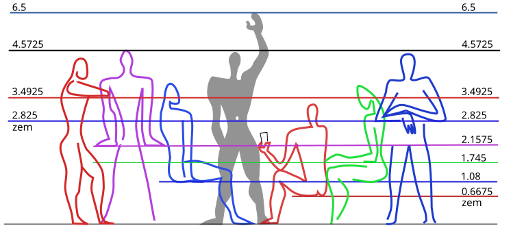
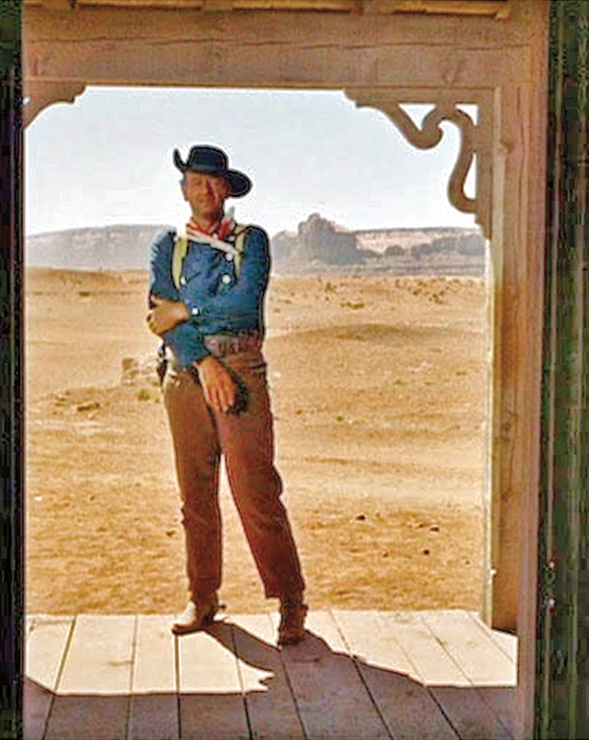
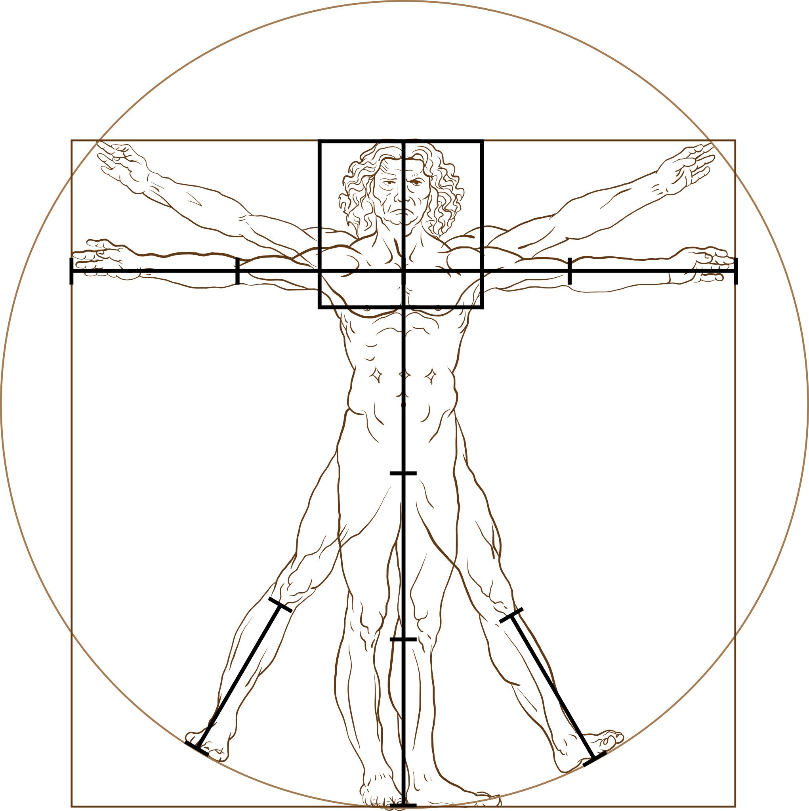

# Dec Measurement System

Code

Introducing Dec, a measurement system, which uses turns instead of months, weeks, hours, minutes, seconds, and degrees.

Author

[Martin Laptev](https://maptv.github.io)

Published

2026+242

Modified

2026+267

![]()

#### 0 Dec measurement system

This part of my website focuses on Dec, a [measurement system](https://en.wikipedia.org/wiki/System_of_units_of_measurement#:~:text=a%20collection%20of%20units%20of%20measurement%20and%20rules%20relating%20them%20to%20each%20other) that [I](https://maptv.github.io) created. All Dec measurements are based on [turns](https://en.wikipedia.org/wiki/Turn_%28angle%29#:~:text=a%20unit%20of%20plane%20angle%20measurement%20equal%20to%202%CF%80%C2%A0radians%2C%20360%C2%A0degrees). In Dec, turns can be combined [metric prefixes](https://en.wikipedia.org/wiki/Metric_prefix#:~:text=a%20unit%20prefix%20that%20precedes%20a%20basic%20unit%20of%20measure%20to%20indicate%20a%20multiple%20or%20submultiple%20of%20the%20unit), such as [deci](https://en.wikipedia.org/wiki/Deci-#:~:text=a%20decimal%20unit%20prefix%20in%20the%20metric%20system%20denoting%20a%20factor%20of%20one%20tenth), [centi](https://en.wikipedia.org/wiki/Centi-#:~:text=a%20unit%20prefix%20in%20the%20metric%20system%20denoting%20a%20factor%20of%20one%20hundredth), or [milli](https://en.wikipedia.org/wiki/Milli-#:~:text=a%20unit%20prefix%20in%20the%20metric%20system%20denoting%20a%20factor%20of%20one%20thousandth), and can have different names depending on what they measure. For example, Dec measures [longitude](https://en.wikipedia.org/wiki/Longitude#:~:text=denoted%20by%20the%20Greek%20letter%20lambda) in [wěi](https://en.wiktionary.org/wiki/%E7%B7%AF#:~:text=(geography)-,latitude,-coordinate%20terms%C2%A0%E2%96%B2) ([w](#w)), [latitude](https://en.wikipedia.org/wiki/Latitude#:~:text=denoted%20by%20the%20Greek%20lower%2Dcase%20letter%20phi) in [jīng](https://en.wikipedia.org/wiki/Meridian_arc#Full_meridian_(polar_perimeter):~:text=The%20polar%20Earth%27s%20circumference%20is%20simply%20four%20times%20quarter%20meridian) ([j](#j)), and [compass](https://en.wikipedia.org/wiki/Compass#:~:text=a%20device%20that%20shows%20the%20cardinal%20directions%20used%20for%20navigation%20and%20geographic%20orientation)🧭directions in [roses](https://en.wikipedia.org/wiki/Compass_rose#:~:text=a%20polar%20diagram%20displaying%20the%20orientation%20of%20the%20cardinal%20directions)🌹([r](#r)).

#### 1 Longitude latitude course

[Table 1](#tbl-map) below⬇️provides the longitude in milliwěi ([mw](#mw)) and latitude in millijīng ([mj](#mj)) of Points 0 and 1 on the [map](#fig-distmap)🗺️beneath [Table 1](#tbl-map). The milli prefix means a thousandth (10⁻³). By default, Point 0 is at 800 [mw](#mw) and 0 [mj](#mj), near the [Galápagos🏝️archipelago](https://en.wikipedia.org/wiki/Gal%C3%A1pagos_Islands#:~:text=an%20archipelago%20of%20volcanic%20islands%20in%20the%20Eastern%20Pacific) of [Ecuador](https://en.wikipedia.org/wiki/Ecuador#:~:text=a%20country%20in%20northwestern%20South%20America)🇪🇨, and Point 1 is at 800 [mw](#mw) and 100 [mj](#mj), near the bottom of the [Missouri bootheel](https://en.wikipedia.org/wiki/Missouri_Bootheel#:~:text=a%20salient%20(protrusion)%20located%20in%20the%20southeasternmost%20part%20of%20the%20U.S.%20state%20of%20Missouri) in the [United States](https://en.wikipedia.org/wiki/United_States#:~:text=a%20country%20primarily%20located%20in%20North%20America)🇺🇸.

Alongside the [geographic coordinates](https://en.wikipedia.org/wiki/Geographic_coordinate_system#:~:text=positions%20directly%20on%20Earth%20as%20latitude%20and%20longitude) of one of the two points, each row of [Table 1](#tbl-map) contains the [course](https://en.wikipedia.org/wiki/Azimuth#:~:text=%20azimuth%20is%20usually%20denoted%20alpha) in milliroses ([mr](#mr)) we would need to maintain to travel🧳the shortest path to the other point. The shortest path between the two points is shown as orange🟠dots on the [map](#fig-distmap). The default courses in [mr](#mr) are 0 (North) from Point 0 to 1 and 500 (South) from Point 1 to 0.

To move the points, click the [map](#fig-distmap) or edit their coordinates in [Table 1](#tbl-map). The [toggle](https://observablehq.com/framework/inputs/toggle)✅inputs above⬆️[Table 1](#tbl-map) add layers to the [map](#fig-distmap): country borders, a rainbow🌈colored grid of Dec [graticules](https://en.wikipedia.org/wiki/Graticule_(cartography)#:~:text=a%20graphical%20depiction%20of%20a%20coordinate%20system%20as%20a%20grid%20of%20lines), a [choropleth](https://en.wikipedia.org/wiki/Choropleth_map#:~:text=a%20type%20of%20statistical%20thematic%20map%20that%20uses%20pseudocolor) of [Coordinated Universal Time](https://en.wikipedia.org/wiki/Coordinated_Universal_Time#:~:text=the%20primary%20time%20standard%20globally%20used%20to%20regulate%20clocks%20and%20time) ([UTC](#utc)) time zones, and a [solar terminator](https://en.wikipedia.org/wiki/Terminator_(solar)#:~:text=a%20moving%20line%20that%20divides%20the%20daylit%20side%20and%20the%20dark%20night%20side%20of%20a%20planetary%20body) with a yellow🟡dot denoting the [point](https://en.wikipedia.org/wiki/Subsolar_point#:~:text=the%20point%20at%20which%20its%20Sun%20is%20perceived%20to%20be%20directly%20overhead) where the Sun☀️is [directly overhead](https://en.wikipedia.org/wiki/Zenith#:~:text=the%20imaginary%20point%20on%20the%20celestial%20sphere%20directly%20%22above%22%20a%20particular%20location): [mw](#mw) and [mj](#mj).

#### 2 Distance speed duration

Dec measures distance or length in [taur](https://en.wikipedia.org/wiki/Turn_(angle)#Tau_proposals:~:text=%E2%81%A0%20turn-,Circumference%20of%20a%20circle,-%F0%9D%90%B6) ([c](#c)), speed in [omegar](https://en.wikipedia.org/wiki/Angular_velocity#:~:text=linear%20velocity%20is%20the%20radius%20times%20the%20angular%20velocity) ([v](#v)), and time in years ([y](#y)) and days ([d](#d)). Each of these four measurement units is based on a physical property of the planet Earth🌍: [c](#c) on its [circumference](https://en.wikipedia.org/wiki/Earth%27s_circumference#:~:text=the%20distance%20around%20Earth), [v](#v) on the speed of its rotation at the [Equator](https://en.wikipedia.org/wiki/Equator#:~:text=the%20circle%20of%20latitude%20that%20divides%20Earth%20into%20the%20Northern%20and%20Southern%20hemispheres) (0 [mj](#mj)), [y](#y) on the duration of its [orbit](https://en.wikipedia.org/wiki/Earth%27s_orbit#:~:text=From%20a%20vantage%20point%20above%20the%20north%20pole%20of%20either%20the%20Sun%20or%20Earth%2C%20Earth%20would%20appear%20to%20revolve%20in%20a%20counterclockwise%20direction%20around%20the%20Sun) around the Sun️, and [d](#d) on the duration of its [rotation](https://en.wikipedia.org/wiki/Earth%27s_rotation#:~:text=the%20rotation%20of%20planet%20Earth%20around%20its%20own%20axis) on its [axis](https://en.wikipedia.org/wiki/Axial_tilt#:~:text=the%20imaginary%20line%20that%20passes%20through%20both%20the%20north%20pole%20and%20south%20pole).

At a speed of 0.5 [v](#v) or 500 milliomegar ([mv](#mv)), we could travel the 0.1 [c](#c) or 100 millitaur ([mc](#mc)) between the default positions📍of Points 0 and 1 in 0.2 [d](#d) or 200 millidays ([md](#md)). The current distance between Points 0 and 1 is [mc](#mc) or [c](#c) and the current travel time between the two points is [mc](#mc) ÷ [v](#v) = [md](#md) = [c](#c) ÷ [v](#v) = [mc](#mc) ÷ [mv](#mv) = [d](#d).

##### Interactive world map

Table 1

Figure 1

##### Color wheel compass

Figure 2

##### Course color table

|     | **mt** | **c°**🧭 | **h°**🎨 | **hex**🎨 |
|-----|--------|----------|----------|-----------|
|     |        |          |          |           |
| NE  | 125    | 45       | 44       | fb0       |
| E   | 250    | 90       | 68       | df0       |
| SE  | 375    | 135      | 96       | 6f0       |
| S   | 500    | 180      | 180      | 0ff       |
| SW  | 625    | 225      | 216      | 06f       |
| W   | 750    | 270      | 264      | 60f       |
| NW  | 875    | 315      | 292      | d0f       |
| N   | 0      | 0        | 0        | f00       |

Table 2

The [color🎨wheel](https://en.wikipedia.org/wiki/Color_wheel#:~:text=an%20abstract%20illustrative%20organization%20of%20color%20hues%20around%20a%20circle) compass above indicates both a [hue](https://en.wikipedia.org/wiki/Hue#:~:text=an%20angular%20position%20around%20a%20central%20or%20neutral%20point%20or%20axis%20on%20a%20color%20space%20coordinate%20diagram) and a course in milliturns ([₥](#mt)). We can convert [₥](#mt) to [compass degrees](https://en.wikipedia.org/wiki/Compass#:~:text=north%20corresponds%20to%200%C2%B0%2C%20and%20the%20angles%20increase%20clockwise%2C%20so%20east%20is%2090%C2%B0%2C%20south%20is%20180%C2%B0%2C%20and%20west%20is%20270%C2%B0) ([c°](#cdeg)): 25 [₥](#mt) = 9[°](#deg), but the conversion of [₥](#mt) to [hue degrees](https://en.wikipedia.org/wiki/HSL_and_HSV#Hue_and_chroma:~:text=measured%20in%20degrees%20%5B0%C2%B0%2C%20360%C2%B0%29) ([h°](#hdeg)) requires a [piecewise function](https://en.wikipedia.org/wiki/Piecewise_function#:~:text=a%20function%20whose%20domain%20is%20partitioned%20into%20several%20intervals). To rotate🔄the color wheel compass, use the “Hue” [range](https://observablehq.com/framework/inputs/range)🎚️and [hue bar](https://observablehq.com/@paavanb/progressive-color-picker) inputs beneath it or change the course from Point 0 to 1 on the [map](#fig-distmap) above.

#### 3 Red green blue (rgb)

Together, the range inputs underneath the hue bar form a “[hue saturation lightness](https://en.wikipedia.org/wiki/HSL_and_HSV#:~:text=HSL%20stands%20for-,hue%2C%20saturation%2C%20and%20lightness,-%2C%20and%20is%20often)” ([HSL](#hsl)) triplet. Like “[red green blue](https://en.wikipedia.org/wiki/RGB_color_model#:~:text=an%20additive%20color%20model)” ([RGB](#rgb)) or [hexadecimal](https://en.wikipedia.org/wiki/Web_colors#Hex_triplet:~:text=hexadecimal%20number%20used%20in%20HTML%2C%20CSS%2C%20SVG%2C%20and%20other%20computing%20applications%20to%20represent%20colors) ([hex](#hex)) triplets, [HSL](#hsl) triplets specify a full-fledged color instead of just a hue. Beneath the hue bar and range inputs, [Table 2](#tbl-color) compares the course from Point 0 to Point 1 in its top row with the [cardinal](https://en.wikipedia.org/wiki/Cardinal_direction#:~:text=north%2C%20south%2C%20east%2C%20and%20west) and [intercardinal](https://en.wikipedia.org/wiki/Cardinal_direction#:~:text=northeast%20(NE)%2C%20southeast%20(SE)%2C%20southwest%20(SW)%2C%20and%20northwest%20(NW)) directions.

Dec color (Decolor) labels🏷️provide a general idea of angular [measure](https://en.wikipedia.org/wiki/Angle#:~:text=The%20magnitude%20of%20an%20angle), regardless of the metric prefixes or measurement [units](https://en.wikipedia.org/wiki/Angle#Units) we use. Therefore, we can reuse♻️Decolors across many different contexts. With the exception of latitude, red designates starting points, like North (0 [r](#r)) and midnight (0 [d](#d)), and cyan denotes midpoints, such as South (0.5 [r](#r)) and noon (0.5 [d](#md)).

> **WARNING:**
>
> Feeling ***disoriented***😵‍💫? Of [***course***](https://en.wikipedia.org/wiki/Course_(navigation)#:~:text=the%20cardinal%20direction%20in%20which%20the%20craft%20is%20to%20be%20steered) you are! Color labels️ can help you find your [***bearings***](https://en.wikipedia.org/wiki/Bearing_(navigation)#:~:text=the%20horizontal%20angle%20between%20the%20direction%20of%20an%20object%20and%20north%20or%20another%20object), stay on [***track***](https://en.wikipedia.org/wiki/Course_(navigation)#:~:text=The%20path%20that%20a%20vessel%20follows), and avoid [***heading***](https://en.wikipedia.org/wiki/Course_(navigation)#:~:text=the%20direction%20where%20the%20watercraft's%20bow%20or%20the%20aircraft's%20nose%20is%20pointed) aches🤕. Orange you glad I couldn’t think of a color pun?

The Equator is the midpoint of the [tropics](https://en.wikipedia.org/wiki/Tropics#:~:text=the%20region%20of%20Earth%20surrounding%20the%20equator%2C%20where%20the%20Sun%20may%20shine%20directly%20overhead) and is the only [major line of latitude](https://en.wikipedia.org/wiki/Circle_of_latitude#Major_circles_of_latitude:~:text=the%20divisions%20between%20the%20five%20principal%20geographical%20zones) that is fixed. The other four major lines of latitude, the Tropics of [Cancer](https://en.wikipedia.org/wiki/Tropic_of_Cancer#:~:text=northernmost%20circle%20of%20latitude%20where%20the%20Sun%20can%20be%20seen%20directly%20overhead)♋(65 [mj](#mj)) and [Capricorn](https://en.wikipedia.org/wiki/Tropic_of_Capricorn#:~:text=the%20southernmost%20latitude%20where%20the%20Sun%20can%20be%20seen%20directly%20overhead)♑️(-65 [mj](#mj)) and the [Arctic](https://en.wikipedia.org/wiki/Arctic_Circle#:~:text=the%20southernmost%20latitude%20at%20which%2C%20on%20the%20winter%20solstice%20in%20the%20Northern%20Hemisphere%2C%20the%20Sun%20does%20not%20rise%20all%20day%2C%20and%20on%20the%20Northern%20Hemisphere%27s%20summer%20solstice%2C%20the%20Sun%20does%20not%20set) (250 [mj](#mj) − 65 [mj](#mj) = 185 [mj](#mj)) and [Antarctic](https://en.wikipedia.org/wiki/Antarctic_Circle#:~:text=the%20Sun%20is%20above%20the%20horizon%20for%2024%20continuous%20hours%20at%20least%20once%20per%20year%20(and%20therefore%20visible%20at%20solar%20midnight)%20and%20the%20centre%20of%20the%20Sun%20(ignoring%20refraction)%20is%20below%20the%20horizon%20for%2024%20continuous%20hours%20at%20least%20once%20per%20year%20(and%20therefore%20not%20visible%20at%20solar%20noon)) (65 [mj](#mj) − 250 [mj](#mj) = -185 [mj](#mj)) Circles, separate the five [geographical zones](https://en.wikipedia.org/wiki/Geographical_zone#:~:text=five%20main%20latitude%20regions) and depend on the [axial tilt](https://en.wikipedia.org/wiki/Axial_tilt#Earth:~:text=the%20angle%20between%20the%20ecliptic%20and%20the%20celestial%20equator%20on%20the%20celestial%20sphere) of the Earth🌏: 65[₥](#mt).

#### 4 Dec time zones

Enable the [“Grid” toggle input](#toggles) above [Table 1](#tbl-map) to see Latitudes [-2](https://en.wikipedia.org/wiki/72nd_parallel_south#:~:text=a%20circle%20of%20latitude%20that%20is%2072%20degrees%20south%20of%20the%20Earth's%20equatorial%20plane%20in%20the%20Antarctic) (-200 [mj](#mj)), [-1](https://en.wikipedia.org/wiki/36th_parallel_south#:~:text=a%20circle%20of%20latitude%20that%20is%2036%20degrees%20south%20of%20the%20Earth's%20equatorial%20plane) (-100 [mj](#mj)), [0](https://en.wikipedia.org/wiki/Equator#:~:text=the%20circle%20of%20latitude%20that%20divides%20Earth%20into%20the%20Northern%20and%20Southern%20hemispheres) (0 [mj](#mj)), [1](https://en.wikipedia.org/wiki/36th_parallel_north#:~:text=a%20circle%20of%20latitude%20that%20is%2036%20degrees%20north%20of%20the%20Earth's%20equatorial%20plane) (100 [mj](#mj)), and [2](https://en.wikipedia.org/wiki/72nd_parallel_north#:~:text=a%20circle%20of%20latitude%20that%20is%2072%20degrees%20north%20of%20the%20Earth's%20equatorial%20plane%2C%20in%20the%20Arctic) (200 [mj](#mj)) on the [map](#fig-distmap) above along with the ten major lines of longitude that divide the Earth🌎into the ten Dec time zones. In Dec, [Longitude 0](https://en.wikipedia.org/wiki/18th_meridian_west#:~:text=a%20line%20of%20longitude%20that%20extends%20from%20the%20North%20Pole%20across%20the%20Arctic%20Ocean%2C%20Greenland%2C%20Iceland%2C%20the%20Atlantic%20Ocean%2C%20the%20Canary%20Islands%2C%20the%20Southern%20Ocean%2C%20and%20Antarctica%20to%20the%20South%20Pole) (0 [mw](#mw)) serves as the [Prime Meridian](https://en.wikipedia.org/wiki/Prime_meridian#:~:text=an%20arbitrarily%2Dchosen%20meridian%20%28a%20line%20of%20longitude%29%20in%20a%20geographic%20coordinate%20system%20at%20which%20longitude%20is%20defined%20to%20be%200%C2%B0), [International Date Line](https://en.wikipedia.org/wiki/International_Date_Line#:~:text=the%20line%20between%20the%20South%20and%20North%20Poles%20that%20is%20the%20boundary%20between%20one%20calendar%20day%20and%20the%20next), the start of Zone 0, and the end of Zone 9.

Like the ten major lines of longitude that separate them, the ten Dec time zones are numbered 0 to 9. The integer assigned to each time zone is its “time zone offset” (tzo). Dec measures tzo in single-digit, non-negative decidays ([dd](#dd)). The deci prefix means a tenth (10⁻¹). To find its corresponding tzo, we [floor](https://en.wikipedia.org/wiki/Floor_and_ceiling_functions#:~:text=the%20greatest%20integer%20less%20than%20or%20equal%20to%20x) the deciwěi ([dw](#dw)) longitude of a location: ⌊⌋ = .

Each Dec time zone is 0.1 [w](#w) wide and 0.5 [j](#j) long. While 1 [j](#j) is always about one (~1) [c](#c) long, the length of a [w](#w) [varies by latitude](https://en.wikipedia.org/wiki/Longitude#Length_of_a_degree_of_longitude:~:text=depends%20only%20on%20the%20radius%20of%20a%20circle%20of%20latitude). At the Equator, a [w](#w) is ~1 [c](#c) long. At the [North](https://en.wikipedia.org/wiki/North_Pole#:~:text=the%20point%20in%20the%20Northern%20Hemisphere%20where%20the%20Earth%27s%20axis%20of%20rotation%20meets%20its%20surface) (250 [mj](#mj)) or [South](https://en.wikipedia.org/wiki/South_Pole#:~:text=the%20point%20in%20the%20Southern%20Hemisphere%20where%20the%20Earth%27s%20axis%20of%20rotation%20meets%20its%20surface) (-250 [mj](#mj)) Pole, the length of a [w](#w) is zero. The approximate length in [c](#c) of a [w](#w) is the [cosine](https://en.wikipedia.org/wiki/Sine_and_cosine#:~:text=the%20ratio%20of%20the%20length%20of%20the%20adjacent%20leg%20to%20that%20of%20the%20hypotenuse) of its latitude, which Dec can calculate using turns, [radians](https://en.wikipedia.org/wiki/Radian#:~:text=the%20dimensionless%20unit%20of%20angle%20in%20the%20International%20System%20of%20Units), or [degrees](https://en.wikipedia.org/wiki/Degree_(angle)#:~:text=a%20unit%20of%20measurement%20of%20a%20plane%20angle%20in%20which%20one%20full%20rotation%20is%20assigned%20the%20value%20of%20360%20degrees): cos() = .

#### 5 Zone equatorial meter (zem)

 [Wikimedia](https://commons.m.wikimedia.org/wiki/File:Modulor_measurements.svg#mw-jump-to-license)

Apart from [c](#c), Dec also measures distance using a unit called the **z**one **e**quatorial **m**eter (zem). The width of a Dec time zone at the Equator is approximately ten million (~10⁷) zem ([z](#z)). Similarly, the distance from the Equator to one of the Poles is ~10⁷ [SI meters](https://en.wikipedia.org/wiki/Metre#Definition:~:text=the%20base%20unit%20of%20length%20in%20the%20International%20System%20of%20Units) ([sim](#sim)). In other words, a decijīng ([dj](#dj)) is ~10⁷ [z](#z) long and a [quarter meridian](https://en.wikipedia.org/wiki/Meridian_arc#Full_meridian_(polar_perimeter):~:text=The%20distance%20from%20the%20equator%20to%20the%20pole) is ~10⁷ [sim](#sim) long: 1 [z](#z) = 0.4 [sim](#sim).

 [Wikimedia](https://commons.wikimedia.org/wiki/File:Typing-colour_for-finger-positions.svg)

#### 6 Length area volume

You can approximate a [z](#z) using your hands🤲. With your palms flat on a table in front of you and the tips of your thumbs👍touching, the maximum distance between the tips of your pinkies is ~1 [z](#z). When you spread out the fingers on one hand✋, make the [ILY](https://en.wikipedia.org/wiki/ILY_sign#:~:text=a%20sign%20from%20a%20combination%20of%20the%20signs%20for%20the%20letters%20I%2C%20L%2C%20and%20Y%20%28for%20%22I%20love%20you%22%29)🤟sign, or the “[call me](https://en.wikipedia.org/wiki/Shaka_sign#:~:text=the%20gesture%20is%20commonly%20understood%20to%20mimic%20the%20handset%20of%20a%20traditional%20landline%20telephone)”, “[drink](https://en.wikipedia.org/wiki/Shaka_sign#:~:text=placing%20the%20thumb%20to%20the%20mouth%20and%20motioning%20the%20little%20finger%20upward%20as%20if%20tipping%20up%20a%20bottle%27s%20bottom%20end)”, or “[shaka](https://en.wikipedia.org/wiki/Shaka_sign#:~:text=a%20gesture%20with%20friendly%20intent%20often%20associated%20with%20Hawaii%20and%20surf%20culture)”🤙sign, your thumb and pinky tips are roughly 0.5 [z](#z) apart.

 [Wikimedia](https://commons.wikimedia.org/wiki/File:Extended_arm.jpg)

To visualize a square zem ([z²](#z2)), imagine two people making a square with their forearms💪. Each of the two people creates a corner and two sides of the square by holding their right elbow with their left hand, like [John Wayne](https://en.wikipedia.org/wiki/John_Wayne#:~:text=Wayne%2C%20was-,an%20American%20actor,-.%20Nicknamed%20%22Duke) at the end of the 1956 film [The Searchers](https://en.wikipedia.org/wiki/The_Searchers#:~:text=a%201956%20American%20epic%20Western%20film), and then completes the square by placing their right hand on the right elbow of other person.

 [True West](https://www.truewestmagazine.com/article/the-searchers-2/#:~:text=he%20grabbed%20his%20right%20arm%20with%20his%20left%20hand%20at%20the%20elbow)

 [Wikimedia](https://commons.wikimedia.org/wiki/File:Man_Lifting_Barbell_Cartoon.svg)

You can also imagine a [z²](#z2) to be square pillow that fits in between your knees and feet🦶when you are sitting or lying on a couch🛋️or a bed🛏️. Each side of the pillow is 1 [z](#z), 4 decimeters, or 16 Dec inches (i) apart, which is probably about the width of your hips or shoulders, and will likely extend from your knees to either your ankles or the soles of your feet.

![]()

[Dimensions.com](https://www.dimensions.com/element/sitting-male-side-1)

#### 7 Typical seat height

According to [dimensions.com](https://www.dimensions.com), 115 [centizem](#cz) ([cz](#cz)) is the [typical seat height](https://www.dimensions.com/element/sitting-female-side-1#:~:text=Seat%20Height%20(Typical)%3A-,18%E2%80%9D%20%7C%2046%20cm,-Style%3A%20Casual) for both men and women in the age range of 25 to 45 [y](#y). The centi prefix means a hundredth (10⁻²). A box📦or [cube pouf](https://www.dimensions.com/element/cube-poufs#:~:text=simple%20forms%20great%20for%20sitting%2C%20foot%20rests%20or%20temporary%20side%20tables) that is the size of a cubic zem ([z³](#z3)) would likely fit under a typical chair or in between the shins of two people sitting in front of each other with their knees and feet 1 [z](#z) apart.

#### 8 Perpetually setting sun

In [Slovak](https://sk.wikipedia.org/wiki/Zem)🇸🇰, [zem](#z) means Earth. This is fitting because all Dec units introduced above are derived from physical attributes of the Earth. At the Equator, the Earth rotates on its axis at a speed of about 1.00224 [v](#v). If we could indefinitely maintain this speed while flying West in an airplane✈️towards the setting sun️, we would be able to perpetually fly [into the sunset](https://tvtropes.org/pmwiki/pmwiki.php/Main/RidingIntoTheSunset)🌅.

#### 9 Airplane cruising speed

To travel fast enough for a perpetual sunset, we would need to be able to [sustain](https://en.wikipedia.org/wiki/Supercruise#:~:text=sustained%20supersonic%20flight) [supersonic](https://en.wikipedia.org/wiki/Supersonic_speed#:~:text=the%20speed%20of%20an%20object%20that%20exceeds%20the%20speed%20of%20sound) flight. The [speed of sound](https://en.wikipedia.org/wiki/Speed_of_sound#:~:text=the%20distance%20travelled%20per%20unit%20of%20time%20by%20a%20sound%20wave)🔊([sos](#sos)) at 15[°](#deg) [Celsius](https://en.wikipedia.org/wiki/Celsius#:~:text=the%20unit%20of%20temperature%20on%20the%20Celsius%20temperature%20scale) and 1 [standard atmosphere](https://en.wikipedia.org/wiki/Standard_atmosphere_(unit)#:~:text=a%20unit%20of%20pressure%20defined%20as%20101325%20Pa) is roughly 0.735048 [v](#v) or Mach 1. [Mach numbers](https://en.wikipedia.org/wiki/Mach_number) are relative to the [sos](#sos), which varies greatly by air temperature and pressure. The [cruising](https://en.wikipedia.org/wiki/Cruise_%28aeronautics%29#:~:text=phase%20of%20aircraft%20flight%20from%20when%20the%20aircraft%20levels%20off%20after%20a%20climb) speed of a [Boeing 747](https://en.wikipedia.org/wiki/Boeing_747#:~:text=sweep%2C%20allowing%20a-,Mach%C2%A00.85,-%28490%C2%A0kn;%20900) is about 0.54 [v](#v) or roughly Mach 0.85.

The highway🛣️speed of a car🚗is approximately tenfold slower than the cruising speed of an airplane️. If we are driving on a highway at a speed of 50 [mv](#mv) and our exit is 1000 [z](#z) away, we will have 20 centimillidays ([cmd](#cmd)) until we have to exit the highway️. To ensure we do not miss our exit, we can periodically check a countdown of the remaining [z](#z): .

#### 10 Centimilliday (cmd)

Dec refers to [cmd](#cmd) as beats ([b](#b)) because they are similar in duration to heart❤️beats or [musical beats](https://en.wikipedia.org/wiki/Beat_(music)#:~:text=I-,n%20music%20and%20music%20theory%2C%20the%20beat%20is%20the%20basic%20unit%20of%20time,-%2C%20the). In Dec, 1 [d](#d) can be split into 100 centiday ([cd](#cd)) or 100000 (10⁵) [b](#b) and 1 [mc](#mc) can be divided into 100 kilozem ([kz](#kz)) or 10⁵ [z](#z). The kilo prefix means a thousand (10³). By changing prefixes and units, we can adapt [mv](#mv) for different [magnitudes](https://en.wikipedia.org/wiki/Magnitude_%28mathematics%29#:~:text=a%20property%20which%20determines%20whether%20the%20object%20is%20larger%20or%20smaller%20than%20other%20objects%20of%20the%20same%20kind): [mv](#mv) = [mc](#mc)/[d](#d) = [kz](#kz)/[cd](#cd) = [z](#z)/[b](#b).

Since 1924, the distance of an Olympic marathon has been 1.054875 [mc](#mc). Dec defines a marathon to be 1 [mc](#mc), which is the [original definition](https://en.wikipedia.org/wiki/Marathon#Distance:~:text=Games%20were%20about-,40%20kilometres,-%2824.9%C2%A0mi) of a marathon from the [first modern Olympic games](https://en.wikipedia.org/wiki/1896_Summer_Olympics#:~:text=the%20first%20international%20Olympic%20Games%20held%20in%20modern%20history) in 1896. The 2026 [world record marathon time](https://en.wikipedia.org/wiki/Marathon#Area_records:~:text=World-,1%3A59%3A30,2026,-Sabastian%20Sawe%C2%A0) is about 83 [md](#md). If we ran 1 [mc](#mc) in 83 [md](#md), our mean [slowness](https://en.wiktionary.org/wiki/slowness#Noun:~:text=the%20reciprocal%20of%20velocity%2C%20that%20delineates%20the%20amount%20of%20time%20required%20for%20an%20object%20to%20travel%20a%20given%20distance) would be 83 [b](#b) per [kz](#kz) and our mean speed would be roughly 12.0482 [mv](#mv).

A brisk walk🚶is about four times slower than a world record marathon. If we walk at 3 [mv](#mv), or 4.8 kilometers per Dec hour, and each of our Dec steps is 2 [z](#z) long, we take 1.5 steps per [b](#b) or 100 steps per Dec minute, a typical walking [cadence](https://en.wikipedia.org/wiki/Cadence_(gait)). Our mean slowness would be about 333 [b](#b) per [kz](#kz), each Dec mile would take 2000 steps and 20 Dec minutes, and the popular daily goal of 10000 steps would cover 5 Dec miles in 100 Dec minutes or about 67 [md](#md).

#### 11 Heart rate tempo

A [normal resting heart rate](https://en.wikipedia.org/wiki/Heart_rate#:~:text=heart%20rate%20is-,60–100%20bpm,-.%20An%20ultra%2Dtrained) is between 86.4 and 144 per [md](#md) ([‰](#permil)). The unofficial anthem of the Dec measurement system, “[Turn the beat around](https://en.wikipedia.org/wiki/Turn_the_Beat_Around#:~:text=a%20disco%20song%20written%20by%20Gerald%20Jackson%20and%20Peter%20Jackson%2C%20and%20performed%20by%20American%20actress%20and%20singer%20Vicki%20Sue%20Robinson%20in%201976)”, has a [tempo](https://en.wikipedia.org/wiki/Tempo#:~:text=the%20speed%20or%20pace%20of%20a%20given%20composition) of 188.64 [‰](#permil), which corresponds to the *allegro* [marking](https://en.wikipedia.org/wiki/Tempo#Approximately_from_the_slowest_to_the_fastest:~:text=120%C2%A0bpm%29-,Allegro,-%E2%80%93%20fast%20and%20bright). A Dec clock⏰ticks at a rate of 100 [‰](#permil), [b](#b)⁻¹, 1/[b](#b), 1 [inverse](https://en.wikipedia.org/wiki/Multiplicative_inverse#:~:text=x%2C%20denoted%20by-,1/x%20or%20x%E2%88%921,-%2C%20is%20a%20number) beat, or 1 perbeat ([þ](#per)), which is 10/9 times more frequent than once per Dec second ([s](#s)).

#### 12 Frequency period wavelength

Dec uses [þ](#per), [b](#b), and [z](#z), often with metric prefixes, to measure the [frequency](https://en.wikipedia.org/wiki/Frequency#:~:text=the%20number%20of%20occurrences%20of%20a%20repeating%20event%20per%20unit%20of%20time), [period](https://en.wikipedia.org/wiki/Frequency#:~:text=the%20reciprocal%20of%20the%20frequency), and [wavelength](https://en.wikipedia.org/wiki/Wavelength#:~:text=the%20distance%20over%20which%20the%20wave%27s%20shape%20repeats), respectively, of a sound or light wave. Equations [1](#eq-freq), [2](#eq-peri), and [3](#eq-wave) below show how frequency, period, and wavelength are related to each other and to speed. The speed of light ([sol](#sol)) is around 647551.709 [v](#v), which is about 880965 times faster than the [sos](#sos).

$$\text{frequency} = \dfrac{\text{speed}}{\text{wavelength}} = \dfrac{1}{\text{period}} \tag{1}$$

$$\text{period} = \dfrac{\text{wavelength}}{\text{speed}} = \dfrac{1}{\text{frequency}} \tag{2}$$

$$\text{wavelength} = \text{speed} \times \text{period} = \dfrac{\text{speed}}{\text{frequency}} \tag{3}$$

The approximate frequency limits of humans senses are 328.32 to 682.56 trillion [þ](#per) for the [visible](https://en.wikipedia.org/wiki/Visible_spectrum#:~:text=the%20band%20of%20the%20electromagnetic%20spectrum%20that%20is%20visible%20to%20the%20human%20eye) light and [10.368](https://en.wikipedia.org/wiki/Hearing_range#:~:text=humans%20can%20hear%20sound%20as%20low%20as%2012%C2%A0Hz) to [24192](https://en.wikipedia.org/wiki/Hearing_range#:~:text=8%5D%20and-,as%20high%20as%2028%C2%A0kHz,-%2C%20though%20the%20threshold) [þ](#per) for [audible](https://en.wikipedia.org/wiki/Hearing_range#:~:text=the%20frequency%20range%20that%20can%20be%20heard%20by%20humans) sound. The range inputs below control the sound player beneath them. The first range input below represents a frequency: [þ](#per), a period: 1000 ÷ [þ](#per) = millibeats ([mb](#mb)), and a wavelength: 735.048 [mv](#mv) ÷ [þ](#per) = [z](#z).

#### 13 Decioctave octave note

In addition to [þ](#per), we can also express frequencies in [octaves](https://en.wikipedia.org/wiki/Octave#:~:text=an%20interval%20between%20two%20notes%2C%20one%20having%20twice%20the%20frequency%20of%20vibration%20of%20the%20other) ([o](#o)), which are twofold changes (doublings) in frequency, or decioctaves ([do](#do)), which are tenths of an [o](#o). The approximate frequency limits are 3 to 103 for human hearing and 23.76 to 3616.64 [þ](#per) or 8 to 80 [do](#do) for an 88-key piano🎹. Equations [4](#eq-octa) and [5](#eq-perb) and the [source code](https://en.wikipedia.org/wiki/Source_code#:~:text=human%20readable%20plain%20text%20that%20eventually%20results%20in%20controlling%20the%20behavior%20of%20a%20computer) below convert between [o](#o) and [þ](#per).

$$\text{o} = \log_2\!\left(\frac{\text{þ}}{14.1275}\right) \tag{4}$$

$$\text{þ} = 14.1275 \times 2^{\text{o}} \tag{5}$$

## Julia

``` julia
perbeat(o) = 14.1275 * 2.0^o
```

    perbeat (generic function with 1 method)

``` julia
octave(p) = log2(p / 14.1275)
```

    octave (generic function with 1 method)

``` julia
octave(113.02)
```

    3.0

``` julia
perbeat(3)
```

    113.02

## Observable JavaScript

``` js
perbeat = o => 14.1275 * 2 ** o;
octave = p => Math.log2(p / 14.1275);
octave(113.02)
```

``` js
perbeat(3)
```

## Python

``` python
import math
perbeat = lambda o: 14.1275 * 2 ** o
octave = lambda p: math.log2(p / 14.1275)
octave(113.02)
```

    3.0

``` python
perbeat(3)
```

    113.02

## R

``` r
perbeat <- \(o) 14.1275 * 2^o
octave <- \(p) log2(p / 14.1275)
octave(113.02)
```

    [1] 3

``` r
perbeat(3)
```

    [1] 113.02

#### 14 Color and sound

Each [do](#do) has a corresponding musical note ([n](#n)) that determines its Decolor label. The idea of linking colors and musical notes dates back to the 1704 book by [Isaac Newton](https://en.wikipedia.org/wiki/Isaac_Newton#:~:text=,an%20English%20polymath,-active%20as%20a) entitled [Opticks](https://en.wikipedia.org/wiki/Opticks#:~:text=a%20collection%20of%20three%20books%20by%20Isaac%20Newton)[^1]. On 2025+080, I read [The Color of Sound](https://www.flutopedia.com/sound_color.htm) by [Clint Goss](https://www.clintgoss.com)[^2], which presents a mathematical method of associating musical notes with colors by matching sound and light frequencies.

$$\text{dividend} \href{https://en.wikipedia.org/wiki/Modulo#:~:text=returns%20the%20remainder%20or%20signed%20remainder%20of%20a%20division}{\mathbin{-\mkern-3.5mu\raise{0.073em}{\scriptstyle\lfloor}}} \text{modulus} = \text{dividend} - \text{modulus} \times \left\lfloor\dfrac{\text{dividend}}{\text{modulus}}\right\rfloor \tag{6}$$

$$\text{n} = \text{o} \href{https://en.wikipedia.org/wiki/Modulo#:~:text=returns%20the%20remainder%20or%20signed%20remainder%20of%20a%20division}{\mathbin{-\mkern-3.5mu\raise{0.073em}{\scriptstyle\lfloor}}} 1 \times 10 \tag{7}$$

The lollipops🍭in the chart below represent the ten Dec notes in Octave 4. The lollipops and the [do](#do) values above them are labeled with the ten main Decolors. Beneath each lollipop is its frequency rounded to the nearest [þ](#per). Click or tap a lollipop to hear its associated Dec sound label. The chart demonstrates that data points can be labeled with both color and sound.

#### 15 Multiplicative inverse pair (mip)

Dec classifies [b](#b) and [þ](#per) as a “[multiplicative inverse](https://en.wikipedia.org/wiki/Multiplicative_inverse#:~:text=denoted%20by,x%E2%88%921) pair” ([mip](#mip)). We can measure period in [b](#b) or [d](#d), frequency in [þ](#per) or inverse days called quotidie ([q](#q)), speed in [v](#v), and slowness in inverse [v](#v) called upsilonr ([ʌ](#ur)). Whereas [d](#d) and [v](#v) are turns ([T](#T)), [q](#q) and [ʌ](#ur) are inverse turns ([ꓕ](#inverset)). The frequency of a [cd](#cd) is 100 [q](#q) or 0.01 [þ](#per). A speed of 10 [mv](#mv) or 0.01 [v](#v) corresponds with a slowness of 100 [ʌ](#ur).

$$\textsf{þ} = \textsf{b}^{\text{-1}} = \dfrac{1}{\textsf{b}} \tag{8}$$

$$\textsf{q} = \textsf{d}^{\text{-1}} = \dfrac{1}{\textsf{d}} \tag{9}$$

$$\textsf{ʌ} = \textsf{v}^{\text{-1}} = \dfrac{1}{\textsf{v}} = \dfrac{\textsf{d}}{\textsf{c}} = \dfrac{\textsf{b}}{\textsf{kz}} \tag{10}$$

$$\style{display:inline-block;transform:rotate(180deg)}{\text{T}} = \text{T}^{\text{-1}} = \dfrac{1}{\text{T}} \tag{11}$$

#### 16 Multiples and submultiples

[Table 3](#tbl-sub) below lists the names, symbols, and [ꓕ](#inverset) values of Dec turn [submultiples](https://en.wikipedia.org/wiki/Multiple_%28mathematics%29#:~:text=of%20%22a%20being-,a%20unit%20fraction,-of%20b%22%20%28a). Outside of Dec, [minutes](https://en.wikipedia.org/wiki/Minute#:~:text=a%20unit%20of%20time%20defined%20as%20equal%20to%2060%20seconds) ([m](#m)) and [seconds](https://en.wikipedia.org/wiki/Second#:~:text=a%20unit%20of%20time%20derived%20from%20the%20division%20of%20the%20day) ([s](#s)) are parts of a day or a degree and are used for both angular and time measurement. Dec extends this flexibility to [hours](https://en.wikipedia.org/wiki/Hour#:~:text=contemporarily%20as%20exactly-,3%2C600%20seconds,-.%20There%20are%2060) ([h](#h)) by redefining [h](#h), [m](#m), and [s](#s) as turn submultiples. In Dec, 1 [h](#h) is 4 centiturns ([¢](#¢)), 1 [m](#m) is 2/3 [₥](#₥), and 1 [s](#s) is 10/9 [b](#b).

| name | symbol | [ꓕ](#inverset) |
|----|----|---:|
| [dime](https://en.wikipedia.org/wiki/Deci-#:~:text=a%20factor%20of%20one%20tenth) | [⅒](#⅒) | 10 |
| [hour](https://en.wikipedia.org/wiki/Hour#:~:text=defined%20contemporarily%20as%20exactly%203%2C600%20seconds) | [h](#h) | 25 |
| [cent](https://en.wikipedia.org/wiki/Centi-#:~:text=a%20factor%20of%20one%20hundredth) | [¢](#¢) | 100 |
| [mil](https://en.wikipedia.org/wiki/Milli-#:~:text=a%20factor%20of%20one%20thousandth) | [₥](#₥) | 1000 |
| [min](https://en.wikipedia.org/wiki/Second#Etymology:~:text=prima%2C%20meaning%20%27-,first%20small%20part,-%27%2C%20i.e.%20first) | [m](#m) | 1500 |
| [line](https://en.wikipedia.org/wiki/Line#Music:~:text=a%20linear%20succession%20of%20musical%20tones) | [l](#l) | 10000 |
| [sec](https://en.wikipedia.org/wiki/Second#Etymology:~:text=minuta%20secunda%2C%20%27-,second%20small%20part,-%27%2C%20dividing%20again%20into) | [s](#s) | 90000 |
| [beat](https://en.wikipedia.org/wiki/Beat#Other_uses_in_music:~:text=the%20basic%20time%20in%20music) | [b](#b) | 100000 |
| [mike](https://en.wikipedia.org/wiki/Micro-#:~:text=a%20factor%20of%20one%20millionth) | [µ](#ud) | 1000000 |

Table 3

Apart from [h](#h), [m](#m), and [s](#s), [Table 3](#tbl-sub) also contains three units named after [currency](https://en.wikipedia.org/wiki/Currency#:~:text=a%20standardized%20form%20of%20money%20used%20as%20a%20medium%20of%20exchange), namely “[dime](https://en.wikipedia.org/wiki/Dime#:~:text=coin%29%2C%20a-,ten%2Dcent%20coin,-and%20subunit%20of)”, “[cent](https://en.wikipedia.org/wiki/Cent#:~:text=a%20one%2Dhundredth%20subdivision%20of%20several%20units%20of%20currency)”, and “[mill](https://en.wikipedia.org/wiki/Mill_%28currency%29#:~:text=1%E2%81%841000%20of%20the%20base%20unit)”, and three more units with names that are inspired by music, poetry, and the performing arts: “[line](https://en.wikipedia.org/wiki/Line#Music:~:text=a%20linear%20succession%20of%20musical%20tones)”, “[beat](https://en.wikipedia.org/wiki/Beat#Other_uses_in_music:~:text=the%20basic%20time%20in%20music)”, and “[mike](https://en.wikipedia.org/wiki/Microphone#:~:text=1%5D%20or-,mike,-%2C%5Ba)”. The names in [Table 3](#tbl-sub) can take the place of a more specific names. For example, “mil” can stand in for [mw](#mw), [mj](#mj), or [mr](#mr).

##### Hour minute second

In Dec, it is easy to convert [hours](#h) to [cents](#¢): 1 [h](#h) = 4 [¢](#¢), [cents](#¢) to [min](#m) or [mil](#₥): 1 [¢](#cd) = 15 [m](#m) = 10 [₥](#₥), minutes to seconds: [m](#m) = 60 [s](#s), and [mil](#₥) to seconds: [₥](#₥) = 90 [s](#s). Comparing [¢](#¢) with [h](#h) or [₥](#₥) with [m](#m) is intuitive because 1 [¢](#¢) is a [quarter-hour](https://en.wiktionary.org/wiki/quarter-hour#:~:text=quarter%20of%20an%20hour%3B%20period%20of%20time%20equal%20to%2015%20minutes) and 1 [₥](#₥) is a 1.5 [m](#m). We can express the current Zone 0 “time of day” (tod) in [b](#b): , as [₥](#₥)+[s](#s): , or as [h](#h)+[m](#m)+[s](#s): .

[Table 4](#tbl-mul) below shows the names, symbols, and [T](#T) values of Dec turn [multiples](https://en.wikipedia.org/wiki/Multiple_%28mathematics%29#:~:text=the%20product%20of%20any%20quantity%20and%20an%20integer). Tables [3](#tbl-sub) and [4](#tbl-mul) are like [mirror images](https://en.wikipedia.org/wiki/Mirror_image#:~:text=a%20reflected%20duplication%20of%20an%20object%20that%20appears%20almost%20identical). The names in [Table 4](#tbl-mul) are all derived from Greek except for [bǎi](https://en.wiktionary.org/wiki/b%C7%8Ei#:~:text=Hanyu%20Pinyin%20reading%20of%20%E7%99%BE) and [xún](https://en.wiktionary.org/wiki/x%C3%BAn#:~:text=Hanyu%20Pinyin%20reading%20of%20%E6%97%AC), which are the [Pinyin](https://en.wikipedia.org/wiki/Pinyin#:~:text=the%20most%20common%20romanization%20system%20for%20Standard%20Chinese) forms of the Chinese characters 百 and 旬, respectively. In Chinese, [百 means 100](https://en.wiktionary.org/wiki/百) and the historical meaning of [旬 is a period of ten days](https://en.wiktionary.org/wiki/旬).

##### Bǎi and xún

In Dec, bǎi means [hecto](https://en.wikipedia.org/wiki/Hecto-#:~:text=a%20factor%20of%20one%20hundred)turn and xún means [deca](https://en.wikipedia.org/wiki/Deca-#:~:text=%28SI%29%20denoting-,a%20factor%20of%20ten,-%2C%20with%20symbol%20da)turn. In Korean, [100](https://en.wikipedia.org/wiki/Korean_numerals#Substitution_for_disambiguation:~:text=hundred,%E7%99%BE) can be written as [백](https://en.wiktionary.org/wiki/백) using [Hangul](https://en.wikipedia.org/wiki/Hangul#:~:text=the%20modern%20writing%20system%20for%20the%20Korean%20language) or as 百 using [Hanja](https://en.wikipedia.org/wiki/Hanja#:~:text=Chinese%20characters%20used%20to%20write%20the%20Korean%20language). Whereas the symbol for xún ([x](#x)) is derived from Pinyin, the symbol for bǎi ([ﾲ](#bai)) is from Hangul. Dec uses [ﾲ](#bai), the first [letter](https://en.wikipedia.org/wiki/Hangul#Letters:~:text=Letters%20in%20the%20Korean%20alphabet%20are%20called%20jamo) in 백, as the symbol for bǎi, because it can, unlike 백 or 百, match the width of all of the other symbols in [Table 4](#tbl-mul).

| name | symbol | t |
|----|----|---:|
| [gig](https://en.wikipedia.org/wiki/Giga-#:~:text=a%20factor%20of%20a%20short%2Dscale%20billion%20or%20long%2Dscale%20milliard) | [G](#g) | 1000000000 |
| [meg](https://en.wikipedia.org/wiki/Mega-#:~:text=a%20factor%20of%20one%20million) | [M](#m) | 1000000 |
| [kilo](https://en.wikipedia.org/wiki/Kilo-#:~:text=multiplication%20by%20one%20thousand) | [k](#k) | 1000 |
| [bǎi](https://en.wikipedia.org/wiki/Korean_birthday_celebrations#Baek_Il_%28%EB%B0%B1%EC%9D%BC%29:~:text=day%20celebration%29.%20The-,100th%20day%20celebration,-originates%20from%20a) | [ﾲ](#bae) | 100 |
| [xún](https://en.wikipedia.org/wiki/Chinese_calendar#:~:text=into%20nine%2D%20or-,ten%2Dday%20weeks,-known%20as%20x%C3%BAn) | [x](#x) | 10 |
| [pent](https://en.wikipedia.org/wiki/Numeral_prefix#Table_of_number_prefixes_in_English:~:text=%5B18%5D-,penta,-%2D) | [p](#p) | 5 |

Table 4

The names in Tables [3](#tbl-sub) and [4](#tbl-mul) can be used on their own, just as kilo could refer to a [kilogram](https://en.wikipedia.org/wiki/Kilogram#:~:text=the%20base%20unit%20of%20mass%20in%20the%20International%20System%20of%20Units) outside of Dec. A kilogram is 1000 grams and a kebigram is 1024 grams, but Dec splits a kilogram into 15625 cubic [cz](#cz) ([cz](#cz)³) and a kebigram into 16000 [cz](#cz)³. In [cz](#cz)³, a kilogram cannot be evenly halved and a kebigram can be evenly halved seven times: 16000 = 125 × 2⁷.

In Dec, 1 [astronomical unit](https://en.wikipedia.org/wiki/Astronomical_unit#:~:text=length%20defined%20as-,149597870700%C2%A0m,-.%5B1) (AU) is 3.74 kilotaur ([kc](#kc)). For astronomy, Dec defines a new unit called a “parallax microturn” (parmic) as 3.74 gigataur / 𝜏. A parmic is roughly equal to 2.51667 light years, 919.22 light days, or 595.239 megataur. A light beat is about 6.4755 [c](#c), which means that light can go around the Earth roughly 6.5 times per [b](#b).

The average distance from the Earth to the Moon is about 9.6 [c](#c). Light can travel twice that distance in roughly 3 [b](#b), but would need about 3 [md](#md) for the shortest possible round trip between Earth and Venus. The approximate distance from Earth to [Proxima Centauri b](https://en.wikipedia.org/wiki/Proxima_Centauri_b#:~:text=an%20exoplanet%20orbiting%20within%20the%20habitable%20zone%20of%20the%20red%20dwarf%20star%20Proxima%20Centauri%20in%20the%20constellation%20Centaurus), the nearest potentially [habitable planet](https://en.wikipedia.org/wiki/Planetary_habitability#:~:text=potential%20to%20develop%20and%20sustain%20an%20environment%20hospitable%20to%20life), is 1 gigataur, 1.68 parmic, or 4.228 light years.

#### 17 Système international d’unités

As a scientist of European origin, I have a strong preference for the [International System of Units](https://en.wikipedia.org/wiki/International_System_of_Units#:~:text=the%20world%27s%20most%20widely%20used%20system%20of%20measurement) ([SI](#si)) over the United States🇺🇸([US](#us)) [customary measurement system](https://en.wikipedia.org/wiki/Imperial_and_US_customary_measurement_systems). Nevertheless, having grown up in the [US](#us), I understand the animosity towards unfamiliar measurement units expressed by Grandpa Simpson in “A Star Is Burns”, Season 6 Episode 18 of [the Simpsons](https://en.wikipedia.org/wiki/The_Simpsons#:~:text=an%20American%20animated%20sitcom).

[](../asset/metric.jpg)

#### 18 US customary units

Dec redefines [US](#us) customary units to facilitate their [conversion](https://en.wikipedia.org/wiki/Conversion_of_units#:~:text=the%20conversion%20of%20the%20unit%20of%20measurement%20in%20which%20a%20quantity%20is%20expressed) to and from [SI](#si) or Dec units. The values in the first column of the tables below are approximate [fold changes](https://en.wikipedia.org/wiki/Fold_change#:~:text=measure%20describing%20how%20much%20a%20quantity%20changes%20between%20an%20original%20and%20a%20subsequent%20measurement) from original to redefined [US](#us) customary units. A fold change of 1 means 0 [change](https://en.wikipedia.org/wiki/Relative_change#:~:text=compare%20two%20quantities%20while%20taking%20into%20account%20the%20%22sizes%22%20of%20the%20things%20being%20compared) is required for alignment with the [SI](#si) and Dec units shown in the second and third column, respectively.

Unlike Dec and [SI](#si), the [US](#us) customary measurement system does not use metric prefixes to scale units by [powers of ten](https://en.wikipedia.org/wiki/Power_of_10#:~:text=any%20of%20the%20integer%20powers%20of%20the%20number%20ten). Redefined [US](#us) customary units can serve as convenient reference points and provide intuitive names for certain fractions and multiples of Dec and [SI](#si) units. For example, after being redefined, one hand is equal to a decimeter or a quarter [z](#z).

#### 19 Length and distance

The [unidimensional](https://en.wiktionary.org/wiki/unidimensional#:~:text=not%20comparable%29-,one%2Ddimensional,-quotations%C2%A0%E2%96%BC) (1D) [US](#us) customary units in [Table 5](#tbl-1d) below can be split into two groups: [human-](https://en.wikipedia.org/wiki/List_of_human-based_units_of_measurement#:~:text=units%20of%20measurement%20based%20on%20human%20body%20parts) or horse-based length units and [surveying](https://en.wikipedia.org/wiki/Surveying#:~:text=determining%20the%20terrestrial%20positions%20of%20points%20based%20on%20the%20distances%20and%20angles%20between%20them) distance units. A horse🐴length is about as long as a [cruiser](https://en.wikipedia.org/wiki/Cruiser_%28motorcycle%29#:~:text=a%20motorcycle%20in%20the%20style%20of%20those%20made%20by%20American%20manufacturers) or [touring motorcycle](https://en.wikipedia.org/wiki/Touring_motorcycle#:~:text=a%20type%20of%20motorcycle%20designed%20for%20touring)🏍️, as long as the [tallest National Basketball🏀Association players](https://en.wikipedia.org/wiki/List_of_tallest_players_in_NBA_history#List) are tall, and roughly half of the length of a [compact](https://en.wikipedia.org/wiki/Compact_car#:~:text=sits%20between%20subcompact%20cars%20and%20mid%2Dsize%20cars) to [mid-size](https://en.wikipedia.org/wiki/Mid-size_car#:~:text=larger%20than%20compact%20cars%20and%20smaller%20than%20full%2Dsize%20cars) car.

| [US](#us) 1D unit | [zem](#z) | [sim](#sim) |
|----|----|----|
| 0.9843 [inches](https://en.wikipedia.org/wiki/Inch) | 0.0625 | 0.025 |
| 0.9843 [palms](https://en.wikipedia.org/wiki/Palm_(unit)) | 0.1875 | 0.075 |
| 0.9843 [hands](https://en.wikipedia.org/wiki/Hand_(unit)) | 0.25 | 0.1 |
| 0.9843 [shaftments](https://en.wikipedia.org/wiki/Shaftment) | 0.375 | 0.15 |
| 0.9942 [links](https://en.wikipedia.org/wiki/Link_(unit)) | 0.5 | 0.2 |
| 0.9843 [spans](https://en.wikipedia.org/wiki/Span_(unit)) | 0.5625 | 0.225 |
| 0.9843 [feet](https://en.wikipedia.org/wiki/Foot_(unit)) | 0.75 | 0.3 |
| 0.9843 [yards](https://en.wikipedia.org/wiki/Yard) | 2.25 | 0.9 |
| 0.9843 [fathoms](https://en.wikipedia.org/wiki/Fathom) | 4.5 | 1.8 |
| 1 [horse length](https://en.wikipedia.org/wiki/Horse_length) | 6 | 2.4 |
| 0.9942 [rods](https://en.wikipedia.org/wiki/Rod_(unit)) | 12.5 | 5 |
| 0.9942 [chains](https://en.wikipedia.org/wiki/Chain_(unit)) | 50 | 20 |
| 0.9942 [furlongs](https://en.wikipedia.org/wiki/Furlong) | 500 | 200 |
| 0.9942 [miles](https://en.wikipedia.org/wiki/Mile) | 4000 | 1600 |
| 0.9942 [leagues](https://en.wikipedia.org/wiki/League_(unit)) | 12000 | 4800 |

Table 5

#### 20 Miles per hour

When we divide a 1D unit by a time unit, we obtain a speed unit. A Dec mile per [h](#h) is exactly one [mv](#mv). We can also equate an [mv](#mv) with microtaur (μc) per [md](#md), or nanotaur (nc) per microday (μd), or [ell](https://en.wikipedia.org/wiki/Ell#:~:text=a%20northwestern%20European%20unit%20of%20measurement) ([ℓ](#ell)) per [s](#s): [mv](#mv) = μc/[md](#md) = nc/μd = [ℓ](#ell)/[s](#s), where [micro](https://en.wikipedia.org/wiki/Micro-#:~:text=a%20factor%20of-,one%20millionth,-%2810%E2%88%926%29.) is a millionth, [nano](https://en.wikipedia.org/wiki/Nano-#:~:text=unit%20prefix%20meaning-,one%20billionth,-.%20Used%20primarily%20with) is a billionth, a μc is a bǎizem ([ﾲz](#bzem)), an nc is a decizem ([dz](#dz)), and an [ℓ](#ell) is a [cubit](https://en.wikipedia.org/wiki/Cubit#:~:text=an%20ancient%20unit%20of%20length%20based%20on%20the%20distance%20from%20the%20elbow%20to%20the%20tip%20of%20the%20middle%20finger) or 10/9 [z](#z).

| [US](#us) speed unit | [mv](#mv) | [kmph](#kmph) |
|----|----|----|
| 1.0253 [inches/second](https://en.wikipedia.org/wiki/Inch_per_second) | 0.05625 | 0.09 |
| 1.0253 [feet/second](https://en.wikipedia.org/wiki/Foot_per_second) | 0.675 | 1.08 |
| 1.0356 [miles/hour](https://en.wikipedia.org/wiki/Miles_per_hour) | 1 | 1.6 |
| 1.0253 yards/second | 2.025 | 3.24 |

Table 6

#### 21 Are hectare acre

If we raise a 1D unit to the second power, we get a [bidimensional](https://en.wiktionary.org/wiki/bidimensional#:~:text=not%20comparable%29-,Two%2Ddimensional,-.) (2D) area unit. A [z²](#z2) is 1 hexamilliare, 16 square (sq.) decimeters ([dm²](#dm2)), ~0.1975 Dec [sq. yards](https://en.wikipedia.org/wiki/Square_yard#:~:text=U.S.%20customary%20unit%20of%20area), 1 + $7\over9$ Dec [sq. feet](https://en.wikipedia.org/wiki/Square_foot#:~:text=the%20area%20of%20a%20square%20with%20sides%20of%201%20foot), or 256 Dec sq. inches. A sq. kilozem ([kz²](#kz2)) is 1 hexakilare, 16 [hectares](https://en.wikipedia.org/wiki/Hectare#:~:text=a%20square%20with%20100%2Dmetre%20sides), 1600 [ares](https://en.wikipedia.org/wiki/Hectare#Are), 40 Dec [acres](https://en.wikipedia.org/wiki/Acre#:~:text=%20is-,a%20unit%20of%20land%20area,-used%20in%20the), 0.16 sq. [kilometers](https://en.wikipedia.org/wiki/Kilometre#:~:text=a%20unit%20of%20length%20in%20the%20International%20System%20of%20Units) ([km²](#km2)), 0.0625 Dec [sq. miles](https://en.wikipedia.org/wiki/Square_mile#:~:text=US%20unit%20of%20measure%20for%20area), 10⁶ [z²](#z2), or 1 megahexamilliare.

| [US](#us) 2D unit | [cz²](#cz2) | [cm²](#cm2) |
|----|----|----|
| 0.9688 [sq. inches](https://en.wikipedia.org/wiki/Square_inch) | 39.0625 | 6.25 |
| 0.9688 [sq. feet](https://en.wikipedia.org/wiki/Square_foot) | 5625 | 900 |
| 0.9688 [sq. yards](https://en.wikipedia.org/wiki/Square_yard) | 50625 | 8100 |
| 0.9884 [acres](https://en.wikipedia.org/wiki/Acre) | 25 × 10⁷ | 4 × 10⁷ |
| 0.9884 [sq. miles](https://en.wikipedia.org/wiki/Square_mile) | 16 × 10¹⁰ | 256 × 10⁸ |

Table 7

#### 22 Drop wineglass keg

[US](#us) tridimensional (3D) volume units tend to scale by [powers of two](https://en.wikipedia.org/wiki/Power_of_two#:~:text=a%20number%20of%20the%20form%202n%20where%20n%20is%20an%20integer). A cubic (cu.) decizem ([dz³](#dz3)) is like a double shot, either of espresso☕️or of liquor🥃, and is equal to 1 cu. nanotaur ([nc³](#nc3)), 1 Dec wineglass (🍷glass), 2 Dec ounces ([u](#u)), 4 Dec tablespoons (table🥄), 64 cu. centimeters (cm³), 64 milliliters ([mL](#mL)), 1000 Dec drops ([g](#g)), or 1000 cu. centizem ([cz³](#cz3)).

| US 3D unit | [cz³](#cz3) | [cm³](#cm3) |
|----|----|----|
| 1.2549 [drops](https://en.wikipedia.org/wiki/Drop_(unit)) | 1 | 0.064 |
| 0.9535 [cu. inches](https://en.wikipedia.org/wiki/Cubic_inch) | 244.140625 | 15.625 |
| 1.0821 [table🥄](https://en.wikipedia.org/wiki/Tablespoon) | 250 | 16 |
| 1.0821 [ounces](https://en.wikipedia.org/wiki/Ounce#Fluid_ounce) | 500 | 32 |
| 1.0821 [🍷glasses](https://en.wikipedia.org/wiki/Wine_glass#Capacity_measure) | 1000 | 64 |
| 0.9468 [cups](https://en.wikipedia.org/wiki/Cup_(unit)) | 3500 | 224 |
| 0.9468 [pints](https://en.wikipedia.org/wiki/Pint) | 7000 | 448 |
| 0.9468 [quarts](https://en.wikipedia.org/wiki/Quart) | 14000 | 896 |
| 0.9468 [gallons](https://en.wikipedia.org/wiki/Gallon) | 56000 | 3584 |
| 0.9535 [cu. feet](https://en.wikipedia.org/wiki/Cubic_foot) | 421875 | 27000 |
| 1.0735 [kegs](https://en.wikipedia.org/wiki/Keg#Specifications_for_a_U.S._1%E2%81%842_barrel_keg) | 1000000 | 64000 |
| 1.0735 [barrels](https://en.wikipedia.org/wiki/Barrel_(unit)) | 2000000 | 128000 |
| 1.0735 [hogsheads](https://en.wikipedia.org/wiki/Hogshead) | 4000000 | 256000 |
| 0.9535 [cu. yards](https://en.wikipedia.org/wiki/Cubic_yard) | 11390625 | 729000 |

Table 8

#### 23 Grain pound ton

Dec and [SI](#si) measurements of mass are based on volumes of water🌊. A [dz³](#dz3) of water weighs $1\over7$ Dec pounds, 64 grams, or 1000 Dec grains ([g](#g)). One [u](#u) of water weighs $1\over14$ Dec pounds, 500 Dec [g](#g), or 32 grams. In Dec, [g](#g) is short for [*granum*](https://en.wiktionary.org/wiki/granum) and [*gutta*](https://en.wiktionary.org/wiki/gutta), the Latin words for grain and drop, respectively. Similarly, [u](#u) originates from [*uncia*](https://en.wiktionary.org/wiki/uncia), the Latin word for “a twelfth”.

| [US](#us) mass unit | grain | gram |
|----|----|----|
| 0.9877 [grains](https://en.wikipedia.org/wiki/Grain_(unit)) | 1 | 0.064 |
| 0.96 [carats](https://en.wikipedia.org/wiki/Carat_(mass)) | 3 | 0.192 |
| 1.1288 [ounces](https://en.wikipedia.org/wiki/Ounce) | 500 | 32 |
| 0.9877 [pounds](https://en.wikipedia.org/wiki/Pound_(mass)) | 7000 | 448 |
| 0.9877 [tons](https://en.wikipedia.org/wiki/Short_ton) | 14000000 | 896000 |

Table 9

#### 24 Body mass index (bmi)

A [z³](#z3) is 1 keg. A keg of water weighs 64 kilograms, 128 Dec pounds, or 1000 Dec kilograins ([kg](#kg)). If [Leonardo da Vinci](https://en.wikipedia.org/wiki/Leonardo_da_Vinci#:~:text=an%20Italian%20polymath%20of%20the%20High%20Renaissance)’s [Vitruvian Man](https://en.wikipedia.org/wiki/Vitruvian_Man#:~:text=a%20drawing%20by%20the%20Italian%20Renaissance%20artist%20and%20scientist%20Leonardo%20da%20Vinci) were 4 [z](#z) tall, we could measure 1 [z](#z) from his knees to his feet or from his elbows to his fingertips. If he also weighed 1000 Dec [kg](#kg), his [body mass index](https://en.wikipedia.org/wiki/Body_mass_index#:~:text=the%20body%20mass%20divided%20by%20the%20square%20of%20the%20body%20height) ([BMI](#bmi)) would be 62.5 [kg](#kg) per [z²](#z2) ($\text {kg}\over\text z^2$) or 25 kilograms per [m²](#m2) ($\text {kilogram}\over\text m^2$).

 [Wikimedia](https://commons.wikimedia.org/wiki/File:Da_Vinci_Vitruve_Luc_Viatour_2.svg)

A normal [BMI](#bmi) ranges from 46.25 to 62.5 $\text {kg}\over\text z^2$ or 18.5 to 25 $\text {kg}\over\text m^2$. An obese person has a [BMI](#bmi) above 75 $\text {kg}\over\text z^2$ or 30 $\text {kg}\over\text m^2$. Severe or morbid obesity is defined as a [BMI](#bmi) above 100 $\text {kg}\over\text z^2$ or 40 $\text {kg}\over\text m^2$. A person with the weight and height selected by the range inputs below would be considered : [kg](#kg) ÷ [z²](#z2) = $\text {kg}\over\text z^2$ = kilograms ÷ [m²](#m2) = $\text {kilograms}\over\text m^2$.

#### 25 Centizem centimeter inch

The longest length depicted in the image of a ruler📏below is 1 [dz](#dz), 1 [nc](#nc), 4 centimeters, or $8\over5$ Dec inches, and the shortest length is $1\over2$ [mz](#mz), $1\over5$ millimeters, $1\over125$ Dec inches, or $1\over127$ [US](#us) customary inches. A [US](#us) customary inch is $127\over2$ [mz](#mz), $127\over5$ millimeters, or $127\over125$ Dec inches. A Dec inch is $5\over2$ centimeters. A centimeter is $5\over2$ [cz](#cz). A [z](#z) is 4 decimeters or 16 Dec inches.

 [Wikimedia](https://commons.wikimedia.org/wiki/File:Ruler_illustration.svg)

#### 26 Claude Boniface Collignon

In 1788, [Claude Boniface Collignon](https://en.wikipedia.org/wiki/Claude_Boniface_Collignon#:~:text=a%20French%20attorney%20who%20contributed%20to%20scientific%20and%20social%20reforms%20in%20the%20time%20of%20the%20French%20Revolution) proposed measuring length in [dz](#dz) or [nc](#nc) and tracking time in [xún](https://en.wikipedia.org/wiki/Chinese_calendar#:~:text=into%20nine%2D%20or-,ten%2Dday%20weeks,-known%20as%20x%C3%BAn) ([x](#x)), [dd](#dd), [md](#md), [µd](#ud), and nanodays ([nd](#nd))[^3]. On 2025+039, while searching for units akin to [c](#c) and [z](#z), I noticed the definition of a zem, 1 [z](#z) = 10⁻⁸ [c](#c) = 40 centimeters, in a table of [ten possible length units](https://www.roma1.infn.it/~dagos/history/sm/node12.html) from an [arxiv](https://arxiv.org/abs/physics/0412078) [article](https://www.roma1.infn.it/~dagos/history/sm/sm.html) entitled “Why does the meter beat the second?”[^4].

#### Summary

This article introduces the Dec measurement system and describes how Dec uses the properties of the planet Earth to define units based on turns for geographic coordinates, compass directions, distances, speeds, areas, volumes, weights, frequencies, wavelengths, and periods. Dec units can be combined with metric prefixes to form multiples or submultiples.

Dec attempts to bridge the gap, improve interoperability, and facilitate conversion between the [US](#us) customary and [SI](#si) measurement systems by redefining certain units. Redefinition of [US](#us) customary units makes most human-based length units ~1.58% shorter and surveying distance units ~0.58% shorter. Dec also redefines [SI](#si) seconds ([sis](#sis)) to be 4% shorter.

Dec color labels can convey an impression of a value at a glance👀. Dec sound labels allow us to quickly estimate a value without even having to look at it🙈. Both types of labels can help avoid confusion when [decimal separators](https://en.wikipedia.org/wiki/Decimal_separator#:~:text=In%20English%2Dspeaking%20countries%2C%20the%20decimal%20point%20is%20usually%20a%20small%20dot%20%28.%29%20placed%20either%20on%20the%20baseline) appear, disappear, or move due to a measurement unit change such as the addition, removal, or replacement of a metric prefix.

#### Next

Now that you have had a taste👅of Dec, I hope that you are hungry🤤for more! If so, dive🤿deeper by reading my article on Dec [dates](../dec/date), [times](../dec/time), and [snaps](../dec/snap). My [filter](../quarto/filter) and [include](../quarto/include) articles discuss the [Quarto](../quarto) publishing system and how I customize my Quarto website to display a Dec [snap](../dec/snap) in the [navigation bar](https://en.wikipedia.org/wiki/Navigation_bar#:~:text=a%20section%20of%20a%20graphical%20user%20interface%20intended%20to%20aid%20visitors%20in%20accessing%20information) and Dec [dates](../dec/date) in the [article list](../list) and [title blocks](https://quarto.org/docs/authoring/title-blocks).

![]()

#### Cite

Of the [bibliography file](https://quarto.org/docs/authoring/citations#bibliography-files) [formats](https://pandoc.org/MANUAL.html#specifying-bibliographic-data) supported by [Quarto](https://quarto.org), I recommend [yaml](https://en.wikipedia.org/wiki/YAML#:~:text=a%20human%2Dreadable%20data%20serialization%20language). The yaml bibliography file shown below contains [bibliographic records](https://en.wikipedia.org/wiki/Bibliographic_record#:~:text=contains%20the%20data%20elements%20necessary%20to%20help%20users%20identify%20and%20retrieve%20that%20resource) ([metadata](https://en.wikipedia.org/wiki/Metadata#:~:text=the%20title%2C%20author%2C%20and%20publication%20date%20of%20a%20book%20are%20metadata%20about%20the%20book)) about the article you are currently reading and the article entitled [`chrono`-Compatible Low-Level Date Algorithms](https://howardhinnant.github.io/date_algorithms) in which [Howard Hinnant](https://howardhinnant.github.io) ([2021+185](#ref-hinnant2021date)) describes the algorithms underlying Dec dates.

``` yml
references:
- id: hinnant2021date
  author:
    - family: Hinnant
      given: Howard
  title: [<code>chrono</code>]{.nocase}-Compatible Low-Level Date Algorithms
  url: https://howardhinnant.github.io/date_algorithms
  issued:
    literal: 2021+185
- id: laptev2026dec
  author:
    - family: Laptev
      given: Martin
  title: Dec Measurement System
  url: https://maptv.github.io/dec
  issued:
    literal: 2026+242
```

Quarto configuration files, such as `_quarto.yml` and `_metadata.yml`, are written in yaml. Quarto input files, including Quarto markdown, [Jupyter](https://jupyter.org) notebook, [markdown](https://quarto.org/docs/authoring/markdown-basics), and specially formatted [script files](https://quarto.org/docs/computations/render-scripts), can start with a [yaml header](https://quarto.org/docs/authoring/front-matter.html). Therefore, we could put the metadata above directly into a Quarto configuration or input file rather than into a bibliography file.

As an alternative to yaml, I suggest the [BibTeX](https://en.wikipedia.org/wiki/BibTeX#:~:text=a%20bibliographic%20flat%2Dfile%20database%20file%20format) format. The BibTeX bibliography file below can be used by Quarto equally as well as the yaml bibliography file above. Regardless of the bibliography file format we choose, Quarto configuration and input files require that we store the [path](https://en.wikipedia.org/wiki/Path_(computing)#:~:text=a%20string%20that%20uniquely%20identifies%20an%20item%20in%20a%20hierarchical%20file%20system) to our bibliography file, or our list of bibliography file paths, in yaml format.

``` bib
@misc{hinnant2021date,
  author = "Howard Hinnant",
  title = "\texttt{chrono}-Compatible Low-Level Date Algorithms",
  url = "https://howardhinnant.github.io/date_algorithms",
  year = 2021+185
}
@misc{laptev2026dec,
  author = "Martin Laptev",
  title = "Dec Measurement System",
  url = "https://maptv.github.io/dec",
  year = 2026+242
}
```

In addition to storing metadata in a bibliography file, we can keep instructions regarding how to style citations and references in a [Citation Style Language](https://quarto.org/docs/authoring/citations#sec-citations-style) (csl) file. If we do not provide a csl file, Quarto will follow the [Chicago Manual of Style](https://chicagomanualofstyle.org) when processing parenthetical citations: ([Hinnant 2021+185](#ref-hinnant2021date)), narrative citations: ([2021+185](#ref-hinnant2021date)), and references:

[Hinnant, Howard](https://howardhinnant.github.io). 2021+185. *`chrono`-Compatible Low-Level Date Algorithms*. <https://howardhinnant.github.io/date_algorithms.html>.

When provided with [`nature.csl`](https://github.com/citation-style-language/styles/blob/master/nature.csl), [`american-medical-association.csl`](https://github.com/citation-style-language/styles/blob/master/american-medical-association.csl), or a similar csl file, Quarto will produce superscript numeric citations, which look just like Quarto [footnotes](https://quarto.org/docs/authoring/markdown-basics#footnotes): [^5]. Unlike Quarto citations, Quarto footnotes do not require any additional files or configuration. A Quarto output file can have both a [Footnotes](#footnotes) and [References](#refs) section.

#### Observable notebooks

In alphabetical order below, you will find a list of the [Observable](http://observablehq.com) [computational notebooks](https://en.wikipedia.org/wiki/Notebook_interface#:~:text=a%20virtual%20notebook%20environment%20used%20for%20literate%20programming) that inspired many of the visualizations above and therefore deserve their own section before the [references](#references) and [footnotes](#footnotes) further below. On the [Observable website](https://observablehq.com), you can [search](https://observablehq.com/search) for other awesome Observable notebooks, read the [blog](https://observablehq.com/blog), or watch [webinars](https://observablehq.com/resource-center#webinars) and [other videos](https://observablehq.com/resource-center#videos).

0.  [Armstrong, Zan](https://observablehq.com/@zanarmstrong). 2023+057. *Text color annotations in markdown*. <https://observablehq.com/@observablehq/text-color-annotations-in-markdown>.
1.  [Bostock, Mike](https://observablehq.com/@mbostock). 2020+335. *Time Zones*. <https://observablehq.com/@mbostock/time-zones>.
2.  [Bostock, Mike](https://observablehq.com/@mbostock). 2022+037. *Solar Terminator*. <https://observablehq.com/@d3/solar-terminator>.
3.  [Bostock, Mike](https://observablehq.com/@mbostock). 2023+314. *Input: Table*. <https://observablehq.com/@observablehq/input-table>.
4.  [Edwards, Paul](https://observablehq.com/@pjedwards). 2022+171. *Compass Rose as legend with colors*. <https://observablehq.com/@pjedwards/compass-rose-as-legend-with-colors>.
5.  [Freedman, Dylan](https://observablehq.com/@freedmand). 2017+345. *Sounds*. <https://observablehq.com/@freedmand/sounds>.
6.  [Gordon, Marcus A.](https://observablehq.com/@magfoto). 2018+288. *Wavelengths and Spectral Colours*. <https://observablehq.com/@magfoto/wavelengths-and-spectral-colours>.
7.  [Harmath, Dénes](https://observablehq.com/user/@thsoft). 2018+104. *ABC*. <https://observablehq.com/@thsoft/abc>.
8.  [Johnson, Ian](https://observablehq.com/@enjalot). 2021+121. *Draggable World Map Coordinates Input*. <https://observablehq.com/@enjalot/draggable-world-map-coordinates-input>.
9.  [Lim, Maddie](https://observablehq.com/@maddievision). 2018+330. *Enneagram*. <https://observablehq.com/@maddievision/enneagram>.
10. [Paavanb](https://observablehq.com/@paavanb). 2024+006. *Progressive Color Picker*. <https://observablehq.com/@paavanb/progressive-color-picker>.
11. [Patel, Amit](https://observablehq.com/@redblobgames). 2021+290. *Compass Rose*. <https://observablehq.com/@paavanb/progressive-color-picker>.
12. [Pettiross, Jeff](https://observablehq.com/@pettiross). 2024+150. *Categorical color scheme test tool*. <https://observablehq.com/@observablehq/categorical-palette-tool>
13. [Rieder, Lukas](https://observablehq.com/@lukasrieder). 2023+032. *Editable table*. <https://observablehq.com/@parlant/editable-table>.
14. [Rivière, Philippe](https://observablehq.com/@fil). 2022+259. *Add a class to an observable input*. <https://observablehq.com/@recifs/add-a-class-to-an-observable-input--support>.
15. [Rivière, Philippe](https://observablehq.com/@fil). 2023+330. *D3 Projections*. <https://observablehq.com/@fil/d3-projections>.
16. [Winkler, Elliot](https://observablehq.com/@mcmire). 2019+070. *Illustrating harmony with the harmonic series*. <https://observablehq.com/@mcmire/illustrating-harmony-with-the-harmonic-series>.
17. [Yamahata, Christophe](https://observablehq.com/@christophe-yamahata). 2021+119. *Great circle: shortest distance between two locations on Earth 🌏*. <https://observablehq.com/@christophe-yamahata/great-circle-shortest-distance-between-two-locations-on-ea>.

#### Glossary

- [a](#arcbeat): arcbeat, a hundred thousandth of a circle, 0.0036 degrees, 0.216 arcminutes, 12.96 arcseconds
  - [ma](#milliarcbeats): milliarcbeat, a thousandth of an arcbeat, a hundred millionth of a circle, 12.96 milliarcseconds
- [b](#beat): beat, centimilliday, a hundred thousandth of a day, 864 milliseconds
  - [mb](#millibeat): millibeat, centimicroday, a thousandth of a beat, a hundred millionth of a day, 864 microseconds
- [bpc](#beatpercentiday): a musical or heart beat per centiday, a tenth of a beat per milliday, 0.069♂ beats per minute, 100 beats per day
- [bpm](#beatpermilliday): a musical or heart beat per milliday, ten beats per centiday, 0.69♂ beats per minute, 1000 beats per day
- [BMI](#bodymassindex): body mass index, kilograins of body mass divided by height in zem squared (kg/z²)
- [b6](#base6): base6, senary, 6 digits written as counting rods, 𝍠 𝍮 𝍯 𝍰 𝍱 𝍭, whose number of horizontal strokes is the value of the digit; the first digit of a Dec minute or second counts tens of Dec minutes or seconds
- [b9](#base9): base9, nonary, 9 digits written as the astronomical symbols of the Sun and the eight planets, ☉ ☿ ♀ ♁ ♂ ♃ ♄ ♅ ♆; the first digit after a tod with Dec seconds appended counts tens of Dec seconds
- [b10](#base10): base10, decimal, the digits 0 to 9
- [b24](#base24): base24, 24 digits written as the lowercase Greek letters α to ω; counts sid after a number of Dec seconds or heh after a UTC offset
- [b25](#base25): base25, pentavigesimal, 25 digits written as Ogham letters; zero-based digits run from the Ogham space mark ( ) for 0 through ᚁ (Beith) for 1 to ᚘ (Ifin) for 24, and one-based digits put ᚙ (Eamhancholl) for 25 in place of the space mark; counts Dec hours
- [ﾲ](#hectoday): a Dec season, 1 hectoday, 10 decadays, or one hundred days; ﾲ, the halfwidth Hangul letter pieup (U+FFB2), looks like a capital H with a line at the bottom; the inspiration for ﾲ is Baek-il (백일), the Korean celebration of the first 100 days of a baby’s life, whose first letter is pieup (ㅂ), and 百日宴 (bǎi rì yàn), the Chinese banquet for the same occasion
  - [piﾲ](#positiveintegerhectoday): positive integer hectoday, ⌊pid ÷ 100⌋, 0 to 3
  - [niﾲ](#negativeintegerhectoday): negative integer hectoday, ⌊nid ÷ 100⌋, -4 to -1
- [c](#taur): taur, 𝜏*r*, 100000 kilozem, 40000 kilometers, nearly the circumference of the Earth, roughly the product of 𝜏 and the radius of the Earth, approximately the dividend of the surface area and the diameter of the Earth
  - [gc](#gigataur): gigataur, a billion taur
  - [kc](#kilotaur): kilotaur, a thousand taur, 10⁸ kilozem
  - [mc](#millitaur): millitaur, *m*𝜏*r*, a thousandth of a taur, 100 kilozem, 40 kilometers
  - [µc](#microtaur): microtaur, *µ*𝜏*r*, a millionth of a taur, 100 zem, 40 meters
  - [nc](#nanotaur): nanotaur, *n*𝜏*r*, a billionth of a taur, 100 millizem, 1 decizem, 4 centimeters
  - [nc³](#cubicnanotaur): cubic nanotaur, *n*𝜏*r*³, 1 cubic decizem
- [d](#day): day, a tenth of a decaday, a seventh of a week, a fifth of a pentaday, 10 decidays, 24 heh, 25 Dec hours, 100 centidays, 1000 millidays, 1440 bem, 1500 Dec minutes, 86400 bes, 90000 Dec seconds, 100000 beats, the inverse of a quotidie
  - [dox](#dayofxun): day of xún
  - [dop](#dayofpentaday): day of pentaday
  - [dom](#dayofmonth): day of month
  - dom_(♀): Decyther day of month, 0 to 28 in Venusian short months or 0 to 29 in Venusian long months
  - [dow](#dayofweek): day of week
  - [doy](#dayofyear): day of year, xún \* 10 + dox
  - [pid](#positiveintegerdoy): positive integer day of year, days elapsed since the beginning of the year, 0 to 364 or 365
  - [nid](#negativeintegerdoy): negative integer day of year, pid − syl, -365 or -366 to -1, the negative of the days left in the year
  - [mid](#mixedintegerdoy): mixed integer day of year, an nid rewritten with negative leading digits (marked by a vinculum) and a positive last digit or two
  - [doe](#dayofera): day of era, days since the Dec epoch
  - [eda](#epochaldayaggregate): epochal day aggregate, doe + tod, days since the Dec epoch including the time of day
  - [edd](#edadifferencedifference): eda difference difference, an eda minus a difference, used to recover the year and ada of a past event
  - [ada](#annualdayaggregate): annual day aggregate, doy + tod
  - [pia](#positiveintervalada): positive interval ada, the time since the start of the current year, equal to the ada
  - [nia](#negativeintervalada): negative interval ada, pia − syl, the negative of the time until the start of the next year
  - [doq](#dayofquadricentennial): day of quadricentennial, days since the start of the current Gregorian quadricentennial, 0 to 146096
  - [doh_(♀)](#dayofhexadecimester): Decyther day of hexadecimester, days since the start of the current 467-day Decyther hexadecimester, doe −⌊ 467, 0 to 466
  - [doﾲ](#dayofhectoday): day of hectoday, doy −⌊ 100, the percent of a hectoday that has elapsed
  - [dob](#dayofbimester): day of bimester, 0 to 58 in common bimesters or 0 to 59 in leap bimesters
  - dob_(♀): Decyther day of bimester, 0 to 57 in antes and the post of Qoh 2 or 0 to 58 in the other posts
  - [dot](#dayoftricennium): day of tricennium, days since the start of the current 30-year lunar cycle, 0 to 10630
  - [doq_(♀)](#dayofquadrimester): Decyther day of quadrimester, days since the beginning of a Decyther quadrimester, 0 to 115 or 116
  - [boq](#beginningofquadrimester): beginning of quadrimester, the pid of Doq_(♀) 0, pid − doq_(♀)
  - [qoh](#quadrimesterofhexadecimester): quadrimester of hexadecimester, zero-based index of a Decyther quadrimester, 0 to 3
  - [bob](#beginningofbimester): beginning of bimester, the pid of Dob 0, pid − dob
  - [bom](#beginningofmonth): beginning of month, the pid of the day before the first day of the month, pid − dom
  - [moh_(♀)](#monthofhexadecimester): Decyther month of hexadecimester, zero-based index of a Venusian month, 0 to 15
  - [bow](#beginningofweek): beginning of week, the pid of Dow 0, pid − dow
  - [boy](#beginningofyear): beginning of year, midnight at the start of Day 0
  - [boe](#beginningofera): beginning of era, midnight at the start of Day 0 of Year 0
  - [boh](#beginningofhexadecimester): beginning of hexadecimester, the start of Doh_(♀) 0 and of the first ante in a Decyther hexadecimester
  - [eoy](#endofyear): end of year, midnight at the end of Day 364 or 365
  - [JDN](#Juliandaynumber): Julian day number, days since the start of the Julian period; increments at noon UTC
  - [lid](#lunarintercalationdifference): lunar intercalation difference, a lunar nid that only resets after lunar leap years, -1063 to -1
  - [ved](#venusianextracalationdifference): Venusian extracalation difference, days until the end of Doh_(♀) 349, the last day of the one-day-shorter Qoh 2, Bimester 5, and Moh_(♀) 11, (doh_(♀) + 117) −⌊ 467 − 467, -467 to -1
  - [mud](#misalignedunitdifference): misaligned unit difference, pid − dom − dow
  - [dd](#deciday): deciday, a tenth of a day, 2.4 heh, 2.5 Dec hours, 144 bem, 150 Dec minutes
  - [cd](#centiday): centiday, a hundredth of a day, 0.24 heh, 0.25 Dec hours, 14.4 bem, 15 Dec minutes
  - [md](#milliday): milliday, a thousandth of a day, 1.44 bem, 1.5 Dec minutes, 90 Dec seconds
  - [dmd](#decimilliday): decimilliday, a ten thousandth of a day, 10 beats, 8640 milliseconds
  - [cmd](#centimilliday): centimilliday, a hundred thousandth of a day, 1 beat, 864 milliseconds
  - [µd](#microday): microday, a millionth of a day, 86.4 milliseconds
  - [nd](#nanoday): nanoday, a billionth of a day, 86.4 microseconds
- [°](#degree): degree, 1/360 turns, 180/𝜋 or 360/𝜏 radians
  - [c°](#compassdegree): compass degree
  - [g°](#greenwichdegrees): Greenwich degree, a longitude in degrees East (positive) or West (negative) of the Greenwich meridian, -180 to 180
  - [h°](#huedegree): hue degree
- [e](#egg): egg, 1000 grains, 2 ounces, 64 grams
- [eot](#equationoftime): equation of time, ast − mst as a function of toy, about -9.8 to 11.4 millidays
- [ℓ](#cubit): ell, cubit, 10/9 zem
- [f](#foot): foot, 0.75 zem, 75 millimeters
- [g](#gutta): drop (gutta in Latin) or grain (granum in Latin), 64 microliters or 64 milligrams
  - [kg](#kilograin): kilograin or kilodrop, 64 grams or 64 milliliters
  - [Mg](#megagrain): megagrain or megadrop, 64 kilograms or 64 liters
- [h](#dechour): Dec hour, a twenty-fifth of a day, 40 millidays, 60 Dec minutes, 3600 Dec seconds, 0.96 heh, 57.6 bem; written as one b25 digit
  - [heh](#hehour): Hipparchian equinoctial hour, a twenty-fourth of a day, 41.♄ millidays, 25/24 Dec hours, 60 bem, 3600 bes
- [hex](#hexadecimal): hexadecimal, base 16
- [HSL](#huesaturationlightness): hue saturation lightness
- [HSV](#huesaturationvalue): hue saturation value
- [i](#inch): inch, a sixteenth of a zem, 25 millimeters
- [ISO](#internationalorganizationforstandardization): [International Organization for Standardization](https://en.wikipedia.org/wiki/International_Organization_for_Standardization), the body behind ISO 8601 dates such as 1970-01-01 (ISO month date) and 1970-W01-4 (ISO week date)
- [j](#jing): jīng (经), a full circle around the Earth moving North or South through both Poles, a measure of latitude; short for 经圈 (jīngquān), “meridian circle,” to emphasize a full circle rather than a meridian, which can be a half circle; an uppercase “J” without a serif is a vertical line drawn from top to bottom, like a jīng running from the North Pole to the South Pole, with a curve at the bottom where the jīng turns to come back up the other side of the Earth; although not the same as the jīng in Běijīng (北京) and Nánjīng (南京), jīng (经) is related to North (Běi) and South (Nán); on a loom, 经 is the warp, the threads that run lengthwise
  - [dj](#decijing): decijīng, a tenth of a jīng (经)
  - [mj](#millijing): millijīng, a thousandth of a jīng (经)
- [k](#keg): keg, cubic zem, 64 liters, 1000 wine glasses, a million drops, half a barrel
- [km](#kilometer): kilometer, 1000 meters, 2500 zem, 2.5 kilozem
- [kmph](#kilometersperhour): kilometers per hour, thousands of meters per Dec hour, 1 kmph = 0.625 mv
- [l](#line): line, decimilliday, a ten thousandth of a day, 10 beats, 8640 milliseconds
- [L](#liter): liter, 15625 drops, a cubic decimeter
  - [mL](#milliliter): milliliter, a cubic centimeter, a thousandth of a liter, 15.625 drops
  - [µL](#microliter): microliter, a cubic millimeter, a millionth of a liter, 0.015625 drops
- [m](#decminute): Dec minute, a fifteen-hundredth of a day, a sixtieth of a Dec hour, 60 Dec seconds, 0.♄ millidays, 0.96 bem, 57.6 bes; written as one b6 digit followed by one b10 digit
  - [bem](#birunianequinoctialminute): Birunian equinoctial minute, a sixtieth of a heh, a fourteen-hundred-fortieth of a day, 0.♄η millidays, 25/24 Dec minutes, 60 bes
- [m²](#squaremeter): square meter, 6.25 square zem
  - [cm²](#squarecentimeter): square centimeter, 6.25 square centizem
  - [dm²](#squaredecimeter): square decimeter, 6.25 square decizem
  - [km²](#squarekilometer): square kilometer, 6.25 square kilozem
  - [cm³](#cubiccentimeter): cubic centimeter, 1 milliliter, a thousandth of a liter, 15.625 drops
- [p](#pentaday): pentaday, a group of five days, half a decaday
  - [pox](#pentadayofxun): pentaday of xún, 0 for Dox 0 to 4 and 1 for Dox 5 to 9
  - [pob](#pentadayofbimester): pentaday of bimester, ⌊dob ÷ 5⌋, 0 to 11
  - [pir](#pentadayinterquintilerange): pentaday interquintile range, Dop 1 to 3, the three days between two lim
  - [lim](#liminalinterconnectingmargin): liminal interconnecting margin, the pair of days between two pir, Dop 4 and the following Dop 0
- [n](#note): note, a specific frequency within an octave
- [NOAA](#nationaloceanicandatmosphericadministration): [National Oceanic and Atmospheric Administration](https://www.noaa.gov), source of the General Solar Position Calculations document
- [o](#octave): octave, a two fold change in frequency
  - [do](#decioctave): decioctave, a tenth of a two fold change in frequency
- [þ](#perbeat): perbeat, the inverse of a beat, 1/beat, once per beat, every beat, 100000 q; symbolized by thorn (þ), which looks like a combination of the letters “p” and “b”; not to be confused with a picobeat (pb)
  - [‰](#permilliday): per milliday, the inverse of a milliday, once per milliday, 1000 q, a hundredth of a perbeat
  - [Tþ](#teraperbeat): teraperbeat, 10¹² perbeat, the inverse of a picobeat, 1/picobeat, once per picobeat, every picobeat
- [q](#quotidie): quotidie, the inverse of a day, a hundred thousandth of a perbeat; the letter “q” in quotidie can be flipped vertically to produce the letter “d” in day
- [r](#rose): compass rose, a full *r*otation along the horizon, 360 compass degrees
  - [saa](#solarazimuthangle): solar azimuth angle, the direction of the Sun along the horizon measured clockwise from North
  - [mr](#millirose): compass millirose, a thousandth of a *r*otation along the horizon, .36 compass degrees
- [rad](#radian): radian, 1/𝜏 turns, 360/𝜏 degrees, 1/𝜋 turns, 180/𝜋 degrees
- [RGB](#redgreenblue): red green blue
- [s](#second): second, Dec second, a sixtieth of a Dec minute, 1/90 millidays, 10/9 beats, 1 Dec second = 0.96 SI seconds
  - [bes](#birunianequinoctialsecond): Birunian equinoctial second, a sixtieth of a bem, 1/86400 days, 1/86.4 millidays, 25/24 Dec seconds; the solar day counterpart of the SI second
  - [Ds](#decasecond): decasecond, ten Dec seconds, 1/9 millidays, 9.6 SI seconds
  - [ds](#decisecond): decisecond, a tenth of a Dec second, 1/900 millidays, 1/9 beats, 96 milliseconds
  - [sid](#secondintervaldifference): second interval difference, 1 SI second − 1 Dec second, 1/24 Dec second, 1/25 SI second, 40 milliseconds
  - [sis](#sisecond): SI second, 25/24 Dec seconds, 1/86.4 millidays, 1/86400 days
- [soi](#spinorbitinterval): spin orbit interval, a lunar day, 1.03505 days
  - [soy](#soiofyear): soi of year
  - [sob](#soiofbimester): soi of bimester
- [SI](#internationalsystemofunits): [International System of Units](https://en.wikipedia.org/wiki/International_System_of_Units#:~:text=the%20world%27s%20most%20widely%20used%20system%20of%20measurement)
- [sim](#simeter): SI meter, the base unit of length in the International System of Units, 2.5 zem, 10 decimeters
- [sol](#speedoflight): speed of light, 647.55170928 kiloomegar, 299792458 meters per second
- [sos](#speedofsound): speed of sound at 15 degrees Celsius, 735.048 milliomegar, 326.688 meters per Dec second, 340.3 meters per SI second
- [sda](#solardeclinationangle): solar declination angle, the latitude at which the Sun is directly overhead
- [sea](#solarelevationangle): solar elevation angle, the angle of the Sun above the horizon, negative when the Sun is below the horizon
- [𝜏](#tau): 2𝜋 or approximately 6.2831853
  - [𝜋](#taudividedby2): pi, 𝜏/2 or approximately 3.1415927
  - [ϡ](#taudividedby900): sampi, the Greek numeral for 900, 𝜏/900 or approximately 0.0069813 radians, 0.4 degrees
- [tod](#timeofday): time of day
  - [bod](#beginningofday): beginning of day, midnight at the start of the day, Tod 0
  - [eod](#endofday): end of day, midnight at the end of the day, 1 day or 10⁵ beats after the bod
  - [pit](#positiveintervaltod): positive interval tod, the time since the start of the current day (previous midnight), equal to the tod
  - [nit](#negativeintervaltod): negative interval tod, pit − 1, the negative of the time until the start of the next day (next midnight)
  - [hms](#hourminutesecond): hour minute second, a tod written as an hod, moh, and sisom triplet
  - [dsisa](#dailysisecondaggregate): daily SI second aggregate, SI seconds since midnight, tod × 86400
  - [hsisa](#hourlysisecondaggregate): hourly SI second aggregate, SI seconds since the top of the hour, dsisa −⌊ 3600
  - [hod](#hourofday): hour of day in heh, ⌊dsisa ÷ 3600⌋, 0 to 23
  - [moh](#minuteofhour): minute of hour in bem, ⌊hsisa ÷ 60⌋, 0 to 59
  - [sisom](#sisecondofminute): SI second of minute, ⌊hsisa −⌊ 60⌋, 0 to 59
  - [mod](#millidayofday): milliday of day, ⌊tod × 1000⌋, 0 to 999
  - [tom](#timeofmilliday): time of milliday, the part of a tod left after its mod, tod × 1000 −⌊ 1 millidays, 0 to 100 beats
  - [til](#timeintegerlength): time integer length, the digit count of a tod or offset written without a decimal separator, including leading zeros; its unit is 10^(-til) days
  - [som](#secondofmilliday): second of milliday, 0 to 89
  - [mst](#meansolartime): mean solar time, solar time based only on longitude and the Zone 0 tod
  - [ast](#apparentsolartime): apparent solar time, mst + eot(toy), solar time based on the actual position of the Sun
  - [law](#lightarcwhole): light arc whole, the time from sunrise to sunset, 1 − naw, sunset − sunrise
  - [lah](#lightarchalf): light arc half, law/2, the time from sunrise to solar noon or from solar noon to sunset
  - [naw](#nightarcwhole): night arc whole, the time from sunset to sunrise, 1 − law
  - [nah](#nightarchalf): night arc half, naw/2, the time from sunset to solar midnight or from solar midnight to sunrise
- [t](#turn): turn, 360 degrees, 𝜏 or 2𝜋 radians
  - [ct](#centiturn): centiturn, a hundredth of a turn, 3.6 degrees, 𝜏/100 or 𝜋/50 radians
  - [dt](#deciturn): deciturn, a tenth of a turn, 36 degrees, 𝜏/10 or 𝜋/5 radians
  - [mt](#milliturn): milliturn, a thousandth of a turn, .36 degrees, 𝜏/1000 or 𝜋/500 radians
- [tzo](#timezoneoffset): time zone offset
- [u](#ounce): ounce (uncia in Latin), 500 grains, 32 grams, 500 drops, 32 milliliters
- [uto](#universaltimeoffset): universal time offset, the offset in decidays that turns a Zone 0 tod into Universal Time; a tzo is an integer uto
  - [sto](#solartimeoffset): solar time offset, any offset added to a Zone 0 tod, written after the tod as tod-offset; represents a single longitude, whereas a tzo is one of the 10 single-digit offsets of the Dec time zones
- [UTC](#coordinateduniversaltime): [Coordinated Universal Time](https://en.wikipedia.org/wiki/Coordinated_Universal_Time#:~:text=the%20primary%20time%20standard%20globally%20used%20to%20regulate%20clocks%20and%20time)
- [US](#unitedstates): [United States](https://en.wikipedia.org/wiki/Imperial_and_US_customary_measurement_systems)
- [UT](#universaltime): [Universal Time](https://en.wikipedia.org/wiki/Universal_Time#:~:text=a%20time%20standard%20based%20on%20Earth%27s%20rotation), a time standard based on the rotation of the Earth
- [v](#omegar): omegar, ωr, 1000 Dec miles per Dec hour, 1.6 megameters per Dec hour, 0.♂ kilometers per Dec second, roughly 1.36 times the speed of sound
  - [kv](#kiloomegar): kiloomegar, kωr, 1.♄ gigameters per hour, 0.4♃♄ megameters per second, approximately 0.1544% of the speed of light
  - [mv](#milliomegar): milliomegar, mωr, 1 Dec mile per Dec hour, 1.6 kilometers per Dec hour, 0.♂ meters per Dec second, 1 zem per beat, approximately 0.136% of the speed of sound
- [w](#wei): wěi (纬), parallel, a full circle around the Earth moving East or West at the same latitude, a measure of longitude; short for 纬圈 (wěiquān), “latitude circle”; can be thought of as a measure of the **w**idth of a jīng on **E**arth; “w” is written from left to right, like a wěi running from **W**est to **E**ast across a map, starts the word “width,” as in the width of a map, and is one of the widest letters in proportional fonts; on a loom, 纬 is the weft, the threads that run crosswise
  - [dw](#deciwei): deciwěi, a tenth of a wěi (纬), a tenth of a parallel
  - [mw](#milliwei): milliwěi, a thousandth of a wěi (纬), a thousandth of a parallel
  - [µw](#microwei): microwěi, a millionth of a wěi (纬), a millionth of a parallel
- [x](#xun): xún (旬), decaday, a group of ten days, 2 pentadays, represented by x like the Roman numeral X
  - [pix](#positiveintegerxun): positive integer xún, ⌊pid ÷ 10⌋, 0 to 36
  - [nix](#negativeintegerxun): negative integer xún, ⌊nid ÷ 10⌋, -37 to -1
  - [mix](#mixedintegerxun): mixed integer xún, the first two digits of an niﾲ mid
  - [xir](#xuninterdecilerange): xún interdecile range, Dox 1 to 8, the days between Dox 0 and 9
- [y](#year): year
  - [my](#milliyear): milliyear, a thousandth of a year
  - [yoe](#yearofera): year of era, integer years since the Dec epoch
  - [eya](#epochalyearaggregate): epochal year aggregate, yoe + toy, years since the Dec epoch including the fraction of the current year
  - [toy](#timeofyear): time of year, the fraction of the year that has elapsed, eya −⌊ 1, ada ÷ syl
  - [ymd](#yearmonthday): year month day, a Gregorian calendar date triplet
  - [syl](#solaryearlength): solar year length, 365 or 366 days, pid − nid
  - [lyl](#lunaryearlength): lunar year length, 354 or 355 days
  - [cey](#commonerayear): common era year, an ISO 8601 (Gregorian calendar) year number
  - [qoe](#quadricentennialofera): quadricentennial of era, quadricentennials since the Dec epoch
  - [yoq](#yearofquadricentennial): year of quadricentennial, years since the start of the current quadricentennial, 0 to 399
  - [yot](#yearoftricennium): year of tricennium, lunar years since the start of the current 30-year lunar cycle, 0 to 29
  - [moy](#monthofyear): month of year, zero-based, Moy 0 is March
  - [woy](#weekofyear): week of year, (boydow + bow) ÷ 7, 0 to 53
  - [wom](#weekofmonth): week of month
- [z](#zoneequatorialmeter): zem, zone equatorial meter, 4 decimeters, 16 inches
  - [kz²](#squarekilozem): square kilozem, a million square zem, megahexamilliare, Mx, hexakilare, 16 hectares, 1600 ares, 40 acres, 0.16 square kilometers, 0.0625 square miles
  - [kz](#kilozem): kilozem, 1000 zem, 400 meters, a quarter mile
  - [z²](#squarezem): square zem, hexamilliare, 16 square decimeters, 1.♅ square feet, 256 square inches
  - [cz²](#squarecentizem): square centizem, a ten-thousandth of a square zem, 16 square millimeters
  - [Dz²](#squaredecazem): square decazem, 1 hexadeciare, 16 square meters, 19.75 square yards, 100 square zem
  - [z³](#cubiczem): cubic zem, 1 keg, 64 liters, 1000 wine glasses, a million drops, half a barrel
  - [dz³](#cubicdecizem): cubic decizem, 1000 drops, 64 milliliters, 2 ounces, 1 wine glass
  - [cz³](#cubiccentizem): cubic centizem, 1 drop, 64 microliters
  - [dz](#decizem): decizem, a tenth of a zem, 4 centimeters
  - [cz](#centizem): centizem, a hundredth of a zem, 4 millimeters
  - [mz](#millizem): millizem, a thousandth of a zem, 0.4 millimeters

Back to top

## References

Hinnant, Howard. 2021+185. *`chrono`-Compatible Low-Level Date Algorithms*. <https://howardhinnant.github.io/date_algorithms>.

## Footnotes

## Reuse

[CC BY-SA 4.0](https://creativecommons.org/licenses/by-sa/4.0/)

[^1]: [Newton, Issac](https://en.wikipedia.org/wiki/Isaac_Newton#:~:text=,an%20English%20polymath,-active%20as%20a). 1704. *Opticks*. <https://doi.org/10.5479/sil.302475.39088000644674>.

[^2]: [Clint Goss](https://www.clintgoss.com). 2022+098. *Color of Sound*. <https://www.flutopedia.com/sound_color.htm>.

[^3]: [Collignon, Claude Boniface](https://en.wikipedia.org/wiki/Claude_Boniface_Collignon#:~:text=a%20French%20attorney%20who%20contributed%20to%20scientific%20and%20social%20reforms%20in%20the%20time%20of%20the%20French%20Revolution). 1788. *Découverte d’étalons justes, naturels, invariables et universels*. <https://archive.org/details/dcouvertedtalon00collgoog/page/n68/mode/2up>.

[^4]: [Agnoli, Paolo](http://www.paoloagnoli.it) & [D’Agostini, Giulio](https://www.roma1.infn.it/~dagos). 2004+330. *Why does the meter beat the second?*. <https://arxiv.org/abs/physics/0412078>.

[^5]: [Hinnant, Howard](https://howardhinnant.github.io). 2021+185. *`chrono`-Compatible Low-Level Date Algorithms*. <https://howardhinnant.github.io/date_algorithms.html>.
